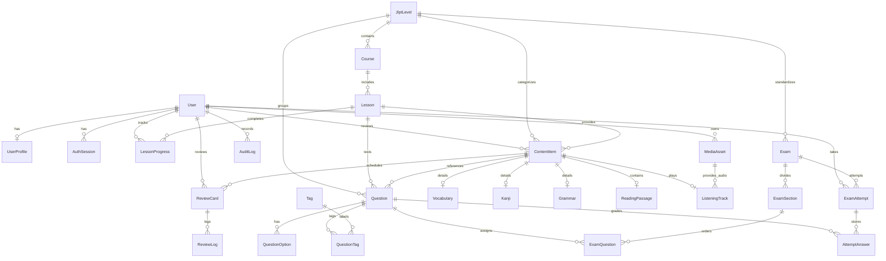

# BÁO CÁO KIỂM TOÁN PHASE 0: KHẢO SÁT & DANH MỤC DỰ ÁN (PROJECT DISCOVERY & INVENTORY)

- **Dự án**: JLPT ManabiHub (JLPT Master)
- **Môi trường Web thực tế**: `https://jlpt.manabihub.me`
- **Phiên bản mã nguồn**: Git branch `deploy`, Commit `9222b22`
- **Ngày kiểm toán**: 28/10/2026 (Cập nhật đối soát hệ thống 03/11/2026)
- **Tiêu chuẩn kiểm toán**: ManabiHub Master Audit Rules (Evidence-First Policy)
- **Đội ngũ kiểm toán**: Autonomous Product Audit Team (Product Owner, UX/UI, Japanese Teacher, Exam Reviewer, Architect, DB Engineer, QA, Security)

---

## 1. TỔNG QUAN KIẾN TRÚC DỰ ÁN (PROJECT ARCHITECTURE OVERVIEW)

### 1.1 Sơ đồ cấu trúc thư mục & Mô hình mã nguồn
Codebase được tổ chức theo mô hình **Modular Monolith** xây dựng trên nền tảng Next.js App Router:

```
00.web_app/
├── app/                              # Next.js App Router (Giao diện & API Routes)
│   ├── (public & guest)/             # /, /login, /register, /onboarding
│   ├── (student routes)/             # /dashboard, /learn, /vocabulary, /kanji, /grammar, /flashcards, /practice, /mock-exams, /results
│   ├── admin/                        # /admin, /admin/content/import
│   ├── prototype/                    # /prototype/header-nav
│   ├── api/                          # /api/health, /api/v1/* (23 tệp route, 24 HTTP method handlers)
│   ├── components/                   # Navbar, BottomNav, LearningToolbar, RubyText, AudioButton,...
│   └── fixtures/                     # Dữ liệu tĩnh dự phòng (n5-curriculum, mock-exam-data, srs-cards)
├── src/                              # Tầng nghiệp vụ máy chủ (Server Core)
│   └── server/
│       ├── db.ts                     # Prisma Client singleton
│       └── services/                 # auth-service, exam-service, srs-service, csv-import-service
├── prisma/                           # ORM & Quản lý dữ liệu
│   ├── schema.prisma                 # Schema chuẩn MariaDB (26 models tương ứng 26 bảng CSDL, mysql provider)
│   └── seed.ts                       # Script seed mẫu N5 (Idempotent 100%)
├── scripts/                          # Khởi tạo & Vận hành Hostinger
│   ├── setup-db.mjs                  # Postbuild: prisma db push + seed
│   └── start-production.mjs          # Entry point production: sync DB + start Next.js
├── tests/                            # Bộ kiểm thử tự động (Vitest)
│   ├── components/                   # Kiểm thử React Testing Library (5 suites)
│   ├── integration/                  # Kiểm thử tích hợp API routes & DB (3 suites)
│   ├── security/                     # OWASP, RBAC, IDOR, Exam Secrecy (4 suites)
│   ├── unit/                         # Thuật toán SRS, Validation (1 suite)
│   └── e2e/                          # Luồng người dùng tích hợp máy chủ (1 suite)
├── docs/                             # Tài liệu kỹ thuật, kiến trúc & kiểm toán
└── prompt/                           # Tài liệu hướng dẫn & Audit Master Prompts
```

### 1.2 Phân tích tệp cấu hình cốt lõi
- **`next.config.ts`**:
  - `output: "standalone"`: Tối ưu hóa đóng gói để triển khai Node.js trên Hostinger mà không cần toàn bộ `node_modules`.
  - `experimental: { cpus: 2 }`: Giới hạn luồng biên dịch Webpack để tránh tràn RAM/CPU throttling trên hạ tầng Shared/Cloud Hosting.
- **`tsconfig.json`**:
  - `target: "ES2017"`, `moduleResolution: "bundler"`, `strict: true`.
  - Path alias: `@/*` trỏ về thư mục gốc `./*`.
- **`package.json`**:
  - **Dependencies chính**: `next` (16.4.3), `react` (19.3.0), `react-dom` (19.3.0), `@prisma/client` (^6.19.3), `zod` (^4.6.7), `lucide-react` (^1.62.0).
  - **DevDependencies**: `prisma` (^6.19.3), `vitest` (^3.2.7), `@testing-library/react` (^16.3.3), `jsdom` (^30.1.3), `tailwindcss` (^4), `tsx` (^4.23.15), `typescript` (^5).
  - **Thiếu sót ghi nhận**: Chưa cài đặt `playwright` (dù SPEC đề cập E2E Playwright) và chưa có `@aws-sdk/client-s3` (dù SPEC quy định S3 Object Storage).
- **Danh sách Biến Môi trường (Environment Variables) khai báo**:
  - Cơ sở dữ liệu: `DATABASE_URL`, `TEST_DATABASE_URL`, `DATABASE_POOL_MAX`.
  - Định danh & Ứng dụng: `SITE_URL`, `NEXTAUTH_URL`, `HOSTNAME`, `PORT`, `TRUST_PROXY`, `NEXT_TELEMETRY_DISABLED`.
  - Bảo mật & Phiên: `AUTH_SECRET`, `SESSION_SECRET`, `SEED_ADMIN_EMAIL`.
  - Lưu trữ đa phương tiện (S3): `S3_ENDPOINT`, `S3_BUCKET`, `S3_ACCESS_KEY`, `S3_SECRET_KEY`.

---

## 2. XÁC MINH CÔNG NGHỆ THỰC TẾ (TECHNOLOGY VERIFICATION — DISC-002)

| Thành phần kỹ thuật | Công nghệ & Phiên bản thực tế | Trạng thái xác minh | Ghi chú & Bằng chứng mã nguồn |
| :--- | :--- | :--- | :--- |
| **Frontend Framework** | Next.js 16.4.3 (App Router), React 19.3.0 | `VERIFIED` | [package.json](file:///d:/100.JLPT/_other/00.web_app/package.json#L21-L23) |
| **Backend Runtime** | Node.js (Next.js Route Handlers) | `VERIFIED` | [scripts/start-production.mjs](file:///d:/100.JLPT/_other/00.web_app/scripts/start-production.mjs#L1-L50) |
| **Database Engine** | MariaDB 10.11 (InnoDB, utf8mb4) | `VERIFIED` | [docker-compose.yml](file:///d:/100.JLPT/_other/00.web_app/docker-compose.yml#L3-L14) |
| **ORM & Driver** | Prisma Client ^6.19.3 (`provider = "mysql"`) | `VERIFIED` | [prisma/schema.prisma](file:///d:/100.JLPT/_other/00.web_app/prisma/schema.prisma#L9-L12) |
| **Cơ chế Xác thực (Auth)** | Giả lập client-side `localStorage` (`jlpt_auth_role`, `jlpt_auth_email`) | `VERIFIED` | [app/login/page.tsx](file:///d:/100.JLPT/_other/00.web_app/app/login/page.tsx#L15-L20) — Chưa tích hợp NextAuth / Auth.js thật vào API handlers |
| **State Management** | React Hooks (`useState`, `useEffect`) + `localStorage` | `VERIFIED` | Toàn bộ các component trong `app/` |
| **Styling & UI Components** | Tailwind CSS v4 + Lucide React + custom UI components | `VERIFIED` | [package.json](file:///d:/100.JLPT/_other/00.web_app/package.json#L20-L39) |
| **API Architecture** | REST-like Route Handlers (`/api/v1/*`) | `VERIFIED` | 23 Route Handlers tại [app/api/](file:///d:/100.JLPT/_other/00.web_app/app/api) |
| **Background Jobs** | Không có (None) | `VERIFIED` | Không có Redis, BullMQ hoặc Cron worker nội bộ |
| **Cache Layer** | In-memory Next.js / Không cấu hình cache ngoài | `VERIFIED` | Không có Redis / Memcached |
| **Media Storage** | Trình duyệt Web Speech API / Chưa kết nối S3 | `VERIFIED` | [app/components/AudioButton.tsx](file:///d:/100.JLPT/_other/00.web_app/app/components/AudioButton.tsx#L25-L35) |
| **Môi trường Triển khai** | Hostinger Node.js Application / Hostinger VPS | `VERIFIED` | [scripts/start-production.mjs](file:///d:/100.JLPT/_other/00.web_app/scripts/start-production.mjs) & `.env.production.example` |

---

## 3. DANH MỤC TOÀN BỘ ĐƯỜNG DẪN TRANG (ROUTE INVENTORY — DISC-003)

Hệ thống hiện có tổng cộng **19 đường dẫn trang (Pages)** và **1 Layout dùng chung**:

| STT | Đường dẫn (Path) | Tên màn hình | Mục đích chức năng | Yêu cầu Auth / Role | Kết nối API thực tế | Trạng thái Loading / Error | Trạng thái hoàn thiện UI |
| :---: | :--- | :--- | :--- | :---: | :--- | :---: | :---: |
| 1 | `/` | Trang chủ (Landing Page) | Giới thiệu nền tảng, lộ trình N5–N1, CTA | Public / Guest | Không | Không có skeleton | `COMPLETE` |
| 2 | `/login` | Đăng nhập | Đăng nhập tài khoản học viên/quản trị | Guest | Không gọi API (lưu `localStorage`) | Báo lỗi form cơ bản | `PARTIAL` |
| 3 | `/register` | Đăng ký | Đăng ký tài khoản học mới | Guest | Không gọi API (chuyển `/onboarding`) | Báo lỗi form cơ bản | `PARTIAL` |
| 4 | `/onboarding` | Khởi tạo mục tiêu | Chọn trình độ (N5) & thời gian học | Guest / Student | Không gọi API (lưu `localStorage`) | Không | `PARTIAL` |
| 5 | `/dashboard` | Trang tổng quan | Xem streak, bài học dở, thẻ SRS, kết quả thi | Student | `GET /api/v1/progress/overview` | Fallback giá trị mặc định | `PARTIAL` |
| 6 | `/learn` | Điều hướng học tập | Chuyển hướng tự động về `/learn/n5` | Student | N/A (Redirect) | N/A | `COMPLETE` |
| 7 | `/learn/n5` | Khóa học N5 | Lộ trình các bài học cấp độ N5 | Student | `GET /api/v1/courses?level=N5` | Fallback `MOCK_LESSONS` | `COMPLETE` |
| 8 | `/learn/n5/[lessonSlug]` | Chi tiết bài học N5 | Xem lý thuyết ngữ pháp, từ vựng, kana | Student | Chưa gọi `/api/v1/lessons/:id` | `Suspense fallback` | `MOCK_ONLY` |
| 9 | `/vocabulary` | Sổ tay Từ vựng | Tra cứu từ vựng N5, tìm kiếm đa ngữ | Student | `GET /api/v1/vocabulary` | Đầy đủ Spinner & Error banner | `COMPLETE` |
| 10 | `/kanji` | Sổ tay Chữ Hán | Học Hán tự N5, âm On/Kun, Hán Việt | Student | `GET /api/v1/kanji` | Fallback `DEFAULT_KANJI` | `COMPLETE` |
| 11 | `/grammar` | Sổ tay Ngữ pháp | Cấu trúc ngữ pháp N5, ví dụ, giải thích | Student | `GET /api/v1/grammar` | Fallback `MOCK_GRAMMAR` | `COMPLETE` |
| 12 | `/flashcards` | Ôn tập thẻ nhớ SRS | Lật thẻ, đánh giá 4 mức độ nhớ | Student | `GET /api/v1/reviews/due` & `POST /api/v1/reviews` | Fallback `MOCK_SRS_CARDS` | `PARTIAL` |
| 13 | `/practice` | Luyện tập trắc nghiệm | Làm câu hỏi củng cố, xem giải thích | Student | `GET /api/v1/practice/questions` & `POST /api/v1/practice/submit` | Đầy đủ Spinner & Error alert | `COMPLETE` |
| 14 | `/mock-exams` | Danh mục đề thi thử | Danh sách các đề thi JLPT mô phỏng | Student | `GET /api/v1/exams?level=N5` | Fallback `INITIAL_EXAMS` | `PARTIAL` |
| 15 | `/mock-exams/[attemptId]` | Phòng thi trực tuyến | Làm bài thi có đếm giờ, lưu tạm đáp án | Student | Chưa gọi `/api/v1/attempts/:id/*` | Tự động nộp khi hết giờ | `MOCK_ONLY` |
| 16 | `/results/[attemptId]` | Kết quả thi thử | Báo cáo điểm số, kỹ năng yếu, giải thích | Student | Chưa gọi `/api/v1/attempts/:id/result` | Fallback dữ liệu tĩnh | `MOCK_ONLY` |
| 17 | `/admin` | CMS Quản trị nội dung | Danh sách nội dung, phê duyệt xuất bản | Admin | Chưa gọi `/api/v1/admin/content` | Client-side state | `MOCK_ONLY` |
| 18 | `/admin/content/import` | Nhập CSV hàng loạt | Xem trước & xác thực schema file CSV | Admin | Chưa gọi `/api/v1/admin/content/import/*` | Bảng xem trước tĩnh | `MOCK_ONLY` |
| 19 | `/prototype/header-nav` | Demo thanh điều hướng | Kiểm thử trực quan chuyển đổi vai trò | Internal/Dev | Không | Không | `COMPLETE` |

> [!WARNING]
> **Thiếu sót kiến trúc định tuyến**: Trong toàn bộ thư mục `app/` **không tồn tại** các tệp xử lý trạng thái toàn cục của Next.js: `loading.tsx`, `error.tsx`, và `not-found.tsx`. Nếu xảy ra lỗi biên dịch hoặc crash ở Server Component, trình duyệt sẽ nhận trang lỗi mặc định của Next.js thay vì giao diện thương hiệu ManabiHub.

---

## 4. DANH MỤC ĐIỂM CUỐI DỊCH VỤ MÁY CHỦ (API INVENTORY — DISC-004)

Hệ thống có **24 HTTP Method Handlers** trên **23 tệp Route** (Toàn bộ nằm trong `app/api/`, tệp `app/api/v1/admin/content/route.ts` xuất khẩu đồng thời cả 2 phương thức `GET` và `POST`):

| Phương thức | Đường dẫn API | Xác thực (Auth) | Phân quyền (Authz) | Schema Yêu cầu / Tham số | Schema Phản hồi / Kết quả | Bắt lỗi & Validation | Thực thể DB liên quan | Tính năng FE tiêu thụ |
| :---: | :--- | :---: | :---: | :--- | :--- | :--- | :--- | :--- |
| `GET` | `/api/health` | None | Public | Không | `{ status, uptime, database }` | Try/Catch, status 500 | `SELECT 1` | Monitoring / Healthcheck |
| `GET` | `/api/v1/levels` | None | Public | Không | `{ data: JlptLevel[] }` | Try/Catch | `jlpt_levels` | Header, Onboarding |
| `GET` | `/api/v1/courses` | Optional | Public/Student | Query `?level=N5` | `{ data: Course[] }` | Fallback N5 | `courses`, `lessons` | `/learn/n5` |
| `GET` | `/api/v1/lessons/:id` | Optional | Student | Param `:id` (UUID/slug) | `{ data: Lesson }` | 404 nếu không tìm thấy | `lessons`, `content_items` | Chưa tiêu thụ |
| `POST` | `/api/v1/lessons/:id/complete` | Semi-mock | Student | Body `{ userId? }` | `{ data: LessonProgress }` | Upsert Idempotent | `lesson_progress`, `users` | Chưa tiêu thụ |
| `GET` | `/api/v1/vocabulary` | Optional | Student | Query `?q=&pos=&level=` | `{ data: VocabEntity[] }` | Normalized LIKE search | `vocabulary`, `content_items` | `/vocabulary` |
| `GET` | `/api/v1/kanji` | Optional | Student | Query `?q=&level=` | `{ data: KanjiEntity[] }` | Search theo character/Hán Việt | `kanji`, `content_items` | `/kanji` |
| `GET` | `/api/v1/grammar` | Optional | Student | Query `?q=&level=` | `{ data: GrammarEntity[] }` | Search pattern/meaning | `grammar`, `content_items` | `/grammar` |
| `GET` | `/api/v1/practice/questions` | Optional | Student | Query `?level=&limit=` | `{ data: Question[] }` | Ẩn đáp án đúng (`isCorrect`) | `questions`, `question_options` | `/practice` |
| `POST` | `/api/v1/practice/submit` | Optional | Student | Body `{ questionId, selectedOptionId }` | `{ isCorrect, correctOptionId, explanationVi }` | Chấm điểm server-side | `questions`, `question_options` | `/practice` |
| `GET` | `/api/v1/reviews/due` | Semi-mock | Student | Query `?userId=&limit=` | `{ data: FormattedDueCard[] }` | Fallback user `minh@` | `review_cards`, `content_items` | `/flashcards`, `/dashboard` |
| `POST` | `/api/v1/reviews` | Semi-mock | Student | Body `{ reviewCardId, rating, idempotencyKey }` | `{ success, card, nextDueAt }` | Transaction + Idempotency Log | `review_cards`, `review_logs` | `/flashcards` |
| `GET` | `/api/v1/exams` | Optional | Student | Query `?level=N5` | `{ data: ExamSummary[] }` | Lấy đề `PUBLISHED` | `exams`, `exam_sections` | `/mock-exams` |
| `POST` | `/api/v1/exams/:id/start` | Semi-mock | Student | Param `:id`, Body `{ userId? }` | `{ data: { attemptId, examSnapshot, expiresAt } }` | Snapshot đề, giấu đáp án | `exams`, `exam_attempts` | Chưa tiêu thụ trên FE |
| `GET` | `/api/v1/attempts/:id` | Semi-mock | Owner | Param `:id` | `{ data: { attempt, remainingSeconds } }` | Kiểm tra hạn giờ máy chủ | `exam_attempts` | Chưa tiêu thụ trên FE |
| `PUT` | `/api/v1/attempts/:id/answers` | Semi-mock | Owner | Param `:id`, Body `{ answers }` | `{ data: { savedCount, lastSavedAt } }` | Chặn lưu nếu đã hết giờ | `attempt_answers`, `exam_attempts` | Chưa tiêu thụ trên FE |
| `POST` | `/api/v1/attempts/:id/finish` | Semi-mock | Owner | Param `:id`, Body `{ answers? }` | `{ data: { internalScore, rawCorrect, rawTotal } }` | Transaction chấm điểm duy nhất | `exam_attempts`, `attempt_answers` | Chưa tiêu thụ trên FE |
| `GET` | `/api/v1/attempts/:id/result` | Semi-mock | Owner | Param `:id` | `{ data: { attempt, explanations, score180 } }` | Chặn xem khi chưa nộp (409) | `exam_attempts`, `questions` | Chưa tiêu thụ trên FE |
| `GET` | `/api/v1/progress/overview` | Semi-mock | Student | Query `?userId=` | `{ data: { completedLessons, dueReviews, latestScore } }` | Tổng hợp count DB thật | `lesson_progress`, `review_cards` | `/dashboard` |
| `GET` | `/api/v1/admin/content` | Semi-mock | Admin | Query `?status=&kind=&level=` | `{ data: ContentItem[] }` | Kiểm tra Role ADMIN | `content_items`, `users` | Chưa tiêu thụ trên FE |
| `POST` | `/api/v1/admin/content` | Semi-mock | Admin | Body `{ kind, levelId, title, payload }` | `{ data: ContentItem }` | Ghi nhận AuditLog | `content_items`, `audit_logs` | Chưa tiêu thụ trên FE |
| `POST` | `/api/v1/admin/content/:id/publish` | Semi-mock | Admin | Param `:id` | `{ data: ContentItem }` | Chuyển `PUBLISHED` + AuditLog | `content_items`, `audit_logs` | Chưa tiêu thụ trên FE |
| `POST` | `/api/v1/admin/content/import/preview` | Semi-mock | Admin | Body `{ rows: any[] }` | `{ isValid, validCount, errorCount, rows }` | Zod safeParse từng dòng | Không ghi DB | Chưa tiêu thụ trên FE |
| `POST` | `/api/v1/admin/content/import/commit` | Semi-mock | Admin | Body `{ rows: ValidRow[] }` | `{ success, insertedCount }` | Transaction batch insert | `content_items`, `vocabulary` | Chưa tiêu thụ trên FE |

> [!IMPORTANT]
> **Kẽ hở xác thực định danh (Semi-mock Auth Pattern)**:
> Hầu hết các API cá nhân (`/reviews/due`, `/reviews`, `/lessons/:id/complete`, `/progress/overview`, `/attempts/:id/*`) đều kiểm tra `userId` từ body/query; **nếu thiếu, API tự động fallback về tài khoản mẫu `minh@jlptmaster.vn`**. Cơ chế này giúp giao diện không bị gián đoạn nhưng chưa phải là hệ thống bảo mật production hoàn chỉnh với Session Token/JWT có chữ ký mật mã.

---

## 5. DANH MỤC THỰC THỂ CƠ SỞ DỮ LIỆU (DATABASE INVENTORY — DISC-005)

Hệ thống định nghĩa **26 thực thể (Models)** tương ứng **26 bảng CSDL MariaDB** trong tệp [prisma/schema.prisma](file:///d:/100.JLPT/_other/00.web_app/prisma/schema.prisma):



### Phân loại chi tiết các nhóm bảng:
1. **Định danh & Hồ sơ (Identity & Profiles)**:
   - `users`: `id` (Char 36), `email` (Unique), `password_hash`, `role` (`STUDENT`, `EDITOR`, `ADMIN`), `status`.
   - `user_profiles`: `user_id` (1-1 với User), `target_level`, `daily_goal_minutes`, `timezone`.
   - `auth_sessions`: `session_token`, `expires_at`.
2. **Khung chương trình & Nội dung học (Curriculum & Lessons)**:
   - `jlpt_levels`: `id` (N5..N1), `name_vi`, `rank_order`, `is_active`.
   - `courses`: `level_id`, `slug`, `title_vi`, `status` (`DRAFT`, `IN_REVIEW`, `PUBLISHED`, `ARCHIVED`).
   - `lessons`: `course_id`, `slug`, `title_vi`, `position`, `minutes_estimate`.
   - `content_items`: Thực thể đa hình trung tâm liên kết bài học, cấp độ và loại nội dung.
3. **Thực thể Kiến thức Chuyên sâu (Content Entities)**:
   - `vocabulary`: `surface`, `reading`, `meaning_vi`, `pos`, `search_normalized`, câu ví dụ.
   - `kanji`: `character`, `onyomi_json`, `kunyomi_json`, `han_viet`, `meaning_vi`, `strokes`.
   - `grammar`: `pattern`, `formation_vi`, `meaning_vi`, `explanation_vi`, `nuance_vi`, `examples_json`.
   - `reading_passages`: `text_ja`, `translated_vi`, `difficulty`, `copyright_source`.
   - `listening_tracks`: `transcript_ja`, `transcript_vi`, `duration_seconds`, liên kết `media_assets`.
4. **Hệ thống Ngân hàng Câu hỏi & Đề thi thử (Assessment & Mock Exams)**:
   - `questions`: `prompt_json`, `explanation_vi`, `question_type`, `skill_tag`.
   - `question_options`: `position`, `text_json`, `is_correct` (được giấu khi học viên làm bài).
   - `exams`: `level_id`, `title`, `scoring_policy`.
   - `exam_sections`: `section_type`, `position`, `duration_seconds`, `max_internal_points`.
   - `exam_questions`: Liên kết N-N giữa phân môn đề thi và câu hỏi.
   - `exam_attempts`: Lưu phiên làm bài, `started_at`, `expires_at`, `submitted_at`, `raw_correct`, `internal_score`, `exam_snapshot_json`.
   - `attempt_answers`: Lưu từng câu trả lời của thí sinh.
5. **Thuật toán Ghi nhớ Ngắt quãng (Spaced Repetition System — SRS)**:
   - `review_cards`: `user_id`, `content_item_id`, `due_at`, `interval_seconds`, `ease_factor`, `repetitions`.
   - `review_logs`: `idempotency_key`, `grade` (`AGAIN`, `HARD`, `GOOD`, `EASY`), thời gian cập nhật.
6. **Tiến độ & Quản trị (Progress, Media & Audit)**:
   - `lesson_progress`: Ghi nhận hoàn thành bài học idempotent.
   - `media_assets`: Quản lý metadata file âm thanh/hình ảnh.
   - `audit_logs`: Nhật ký kiểm toán thao tác quản trị viên.

---

## 6. MA TRẬN MỨC ĐỘ HOÀN THIỆN TÍNH NĂNG (FEATURE MATRIX — DISC-006)

| Mã tính năng | Tên tính năng | Frontend | Backend | Database | Automated Tests | Trạng thái người dùng | Bằng chứng mã nguồn (Evidence) |
| :--- | :--- | :---: | :---: | :---: | :---: | :---: | :--- |
| **FEAT-01** | Xác thực & Đăng nhập | `PARTIAL` | `PARTIAL` | `COMPLETE` | `COMPLETE` | `PARTIAL` | Giao diện lưu `localStorage` ([LoginPage](file:///d:/100.JLPT/_other/00.web_app/app/login/page.tsx)); test OWASP pass ([owasp-audit.test.ts](file:///d:/100.JLPT/_other/00.web_app/tests/security/owasp-audit.test.ts)) |
| **FEAT-02** | Khởi tạo Onboarding | `PARTIAL` | `NOT_IMPL` | `COMPLETE` | `NOT_TESTED` | `PARTIAL` | [OnboardingPage](file:///d:/100.JLPT/_other/00.web_app/app/onboarding/page.tsx) chỉ lưu localStorage, chưa gọi API ghi vào `user_profiles` |
| **FEAT-03** | Dashboard tổng quan | `PARTIAL` | `COMPLETE` | `COMPLETE` | `COMPLETE` | `PARTIAL` | Đã nối `dueReviewsCount` DB thật; nhưng streak, số từ vựng, đề thi gần nhất vẫn là dữ liệu cứng ([DashboardPage](file:///d:/100.JLPT/_other/00.web_app/app/dashboard/page.tsx)) |
| **FEAT-04** | Lộ trình Khóa học N5 | `COMPLETE` | `COMPLETE` | `COMPLETE` | `COMPLETE` | `COMPLETE` | Nối trực tiếp `GET /api/v1/courses` ([learn/n5/page.tsx](file:///d:/100.JLPT/_other/00.web_app/app/learn/n5/page.tsx)) |
| **FEAT-05** | Chi tiết Bài học N5 | `MOCK_ONLY` | `COMPLETE` | `COMPLETE` | `NOT_TESTED` | `MOCK_ONLY` | Giao diện bài học dùng tĩnh `MOCK_LESSONS` ([learn/n5/[lessonSlug]/page.tsx](file:///d:/100.JLPT/_other/00.web_app/app/learn/n5/%5BlessonSlug%5D/page.tsx)), chưa gọi `/api/v1/lessons/:id` |
| **FEAT-06** | Sổ tay Từ vựng N5 | `COMPLETE` | `COMPLETE` | `COMPLETE` | `COMPLETE` | `COMPLETE` | Tìm kiếm trực tiếp MariaDB với normalized search ([VocabularyPage](file:///d:/100.JLPT/_other/00.web_app/app/vocabulary/page.tsx)) |
| **FEAT-07** | Sổ tay Chữ Hán N5 | `COMPLETE` | `COMPLETE` | `COMPLETE` | `COMPLETE` | `COMPLETE` | Kết nối `GET /api/v1/kanji` hiển thị Kanji, Hán Việt, âm On/Kun ([KanjiPage](file:///d:/100.JLPT/_other/00.web_app/app/kanji/page.tsx)) |
| **FEAT-08** | Sổ tay Ngữ pháp N5 | `COMPLETE` | `COMPLETE` | `COMPLETE` | `COMPLETE` | `COMPLETE` | Kết nối `GET /api/v1/grammar` ([GrammarPage](file:///d:/100.JLPT/_other/00.web_app/app/grammar/page.tsx)) |
| **FEAT-09** | Thẻ nhớ Ôn tập SRS | `PARTIAL` | `COMPLETE` | `COMPLETE` | `COMPLETE` | `PARTIAL` | Nối API `POST /api/v1/reviews` ghi DB thật; nhưng nếu DB rỗng sẽ fallback về `MOCK_SRS_CARDS` ([FlashcardsPage](file:///d:/100.JLPT/_other/00.web_app/app/flashcards/page.tsx)) |
| **FEAT-10** | Luyện tập Trắc nghiệm | `COMPLETE` | `COMPLETE` | `COMPLETE` | `COMPLETE` | `COMPLETE` | Lấy câu hỏi từ DB, nộp bài chấm điểm server-side, giấu đáp án tuyệt đối ([PracticeQuizPage](file:///d:/100.JLPT/_other/00.web_app/app/practice/page.tsx)) |
| **FEAT-11** | Danh mục Đề thi thử | `PARTIAL` | `COMPLETE` | `COMPLETE` | `COMPLETE` | `PARTIAL` | Lấy đề từ `GET /api/v1/exams`, nhưng trạng thái `COMPLETED` và điểm `142/180` bị gán cứng ([MockExamsCatalogPage](file:///d:/100.JLPT/_other/00.web_app/app/mock-exams/page.tsx#L57)) |
| **FEAT-12** | Phòng thi Trực tuyến | `MOCK_ONLY` | `COMPLETE` | `COMPLETE` | `COMPLETE` | `MOCK_ONLY` | Backend có đầy đủ `/attempts/:id/*` nhưng FE phòng thi chỉ lưu vào `localStorage` từ `MOCK_EXAM_N5_01` ([mock-exams/[attemptId]/page.tsx](file:///d:/100.JLPT/_other/00.web_app/app/mock-exams/%5BattemptId%5D/page.tsx)) |
| **FEAT-13** | Báo cáo Kết quả Thi | `MOCK_ONLY` | `COMPLETE` | `COMPLETE` | `COMPLETE` | `MOCK_ONLY` | Backend có `/attempts/:id/result` nhưng FE hiển thị điểm cứng 142/180 từ biến `scoreData` ([results/[attemptId]/page.tsx](file:///d:/100.JLPT/_other/00.web_app/app/results/%5BattemptId%5D/page.tsx)) |
| **FEAT-14** | CMS Quản trị Nội dung | `MOCK_ONLY` | `COMPLETE` | `COMPLETE` | `COMPLETE` | `MOCK_ONLY` | Backend có API CRUD & AuditLog nhưng màn hình `/admin` quản lý bằng mảng state React nội bộ ([AdminDashboardPage](file:///d:/100.JLPT/_other/00.web_app/app/admin/page.tsx)) |
| **FEAT-15** | Nhập dữ liệu CSV | `MOCK_ONLY` | `COMPLETE` | `COMPLETE` | `COMPLETE` | `MOCK_ONLY` | Backend có API preview/commit với Zod, FE import chỉ hiển thị bảng mẫu có sẵn ([CsvImportPage](file:///d:/100.JLPT/_other/00.web_app/app/admin/content/import/page.tsx)) |
| **FEAT-16** | Phát âm & Audio | `PARTIAL` | `PLACEHOLDER`| `PARTIAL` | `NOT_TESTED` | `PARTIAL` | Phát âm dùng Web Speech API của trình duyệt qua `AudioButton.tsx`; chưa có file MP3/OGG thật trên S3 |

---

## 7. ĐIỀU TRA TÍNH XÁC THỰC CỦA DỮ LIỆU HIỂN THỊ (DATA AUTHENTICITY — DISC-007)

Qua rà soát toàn bộ các thành phần giao diện, đội kiểm toán phát hiện sự phân hóa rõ rệt giữa **Dữ liệu thật từ MariaDB**, **Dữ liệu Seed**, và **Dữ liệu Hardcoded/Mock**:

| Khu vực hiển thị | Con số / Nội dung quan sát | Bản chất thực tế của dữ liệu | Bằng chứng & Phân tích chi tiết |
| :--- | :--- | :--- | :--- |
| **Dashboard: Số thẻ SRS** | Số lượng hiển thị (ví dụ: 8 hoặc 14 thẻ) | **Aggregated DB Result** (Có fallback) | Được fetch từ `GET /api/v1/progress/overview` đếm từ bảng `review_cards`. Nếu lỗi hoặc đã làm trong ngày sẽ đọc từ `localStorage`. |
| **Dashboard: Chuỗi Streak** | `"5 ngày liên tục"` | **Hardcoded Placeholder** | Ghi cứng 100% trong mã nguồn tại [app/dashboard/page.tsx#L68](file:///d:/100.JLPT/_other/00.web_app/app/dashboard/page.tsx#L68). Không có bảng hay trường nào lưu streak trong DB. |
| **Dashboard: Thời lượng học** | `"Mục tiêu hoàn thành 30 phút"` | **Hardcoded Placeholder** | Ghi cứng trong chuỗi văn bản tại [app/dashboard/page.tsx#L55](file:///d:/100.JLPT/_other/00.web_app/app/dashboard/page.tsx#L55). |
| **Dashboard: Bài học dở** | `"Bài 03... Tiến độ 35%"` | **Hardcoded Placeholder** | Ghi cứng thẻ bài học số 3 kèm thanh tiến độ 35% tại [app/dashboard/page.tsx#L88-L100](file:///d:/100.JLPT/_other/00.web_app/app/dashboard/page.tsx#L88-L100). |
| **Dashboard: Tiến độ N5** | `"180 / 800 từ"`, `"45 / 100 chữ"`, `"30 / 80 mẫu"` | **Hardcoded Placeholder** | Toàn bộ 3 thanh tiến độ và số lượng thống kê đều bị hardcode cố định tại [app/dashboard/page.tsx#L194-L220](file:///d:/100.JLPT/_other/00.web_app/app/dashboard/page.tsx#L194-L220). |
| **Dashboard: Kết quả thi gần nhất** | `"142 / 180 điểm"`, link `/results/att-01` | **Hardcoded Placeholder** | Ghi cứng trực tiếp trong component tại [app/dashboard/page.tsx#L238](file:///d:/100.JLPT/_other/00.web_app/app/dashboard/page.tsx#L238). |
| **Sổ tay Từ vựng & Kanji** | Danh sách 20 từ vựng và 5 Kanji | **Seed Data từ MariaDB** | Lấy dữ liệu thật từ bảng `vocabulary` và `kanji` được nạp qua `prisma/seed.ts`. |
| **Khóa học N5 (`/learn/n5`)** | 3 bài học kèm trạng thái hoàn thành | **Seed Data + Hardcoded Status** | Lấy danh sách 3 bài từ DB qua API `/courses`, nhưng trạng thái `isCompleted` bị gán cứng `idx < 2` tại [app/learn/n5/page.tsx#L30](file:///d:/100.JLPT/_other/00.web_app/app/learn/n5/page.tsx#L30). |
| **Chi tiết bài học (`/learn/n5/*`)** | Nội dung ngữ pháp, từ vựng, kana | **Demo Fixtures** | Lấy hoàn toàn từ file tĩnh `app/fixtures/n5-curriculum.ts`. |
| **Phòng thi thử & Kết quả** | 35 câu hỏi thi, điểm 142/180, kỹ năng yếu | **Demo Fixtures & Hardcoded** | Sinh từ `app/fixtures/mock-exam-data.ts`, lưu đáp án vào `localStorage` và hiển thị kết quả cố định từ biến `scoreData`. |

---

## 8. THÔNG TIN CÒN THIẾU & ĐIỂM CHƯA THỂ TIẾP CẬN (MISSING INFORMATION)

1. **Thông tin xác thực production trên Hostinger**: Đội kiểm toán chỉ kiểm tra mã nguồn tĩnh và môi trường kiểm thử cục bộ; chưa có quyền truy cập trực tiếp hPanel Hostinger để xác minh thông số CPU/RAM thực tế và cấu hình tường lửa DB.
2. **Hạ tầng lưu trữ S3 Object Storage**: Chưa có endpoint S3 thật để kiểm thử tải lên và phát trực tiếp file âm thanh bản ghi giọng người bản xứ Nhật (hiện đang dùng Web Speech API).
3. **Cơ chế phân quyền Session thực tế**: Chưa có thư viện session có ký số (như NextAuth/Auth.js session cookie), dẫn đến việc đánh giá bảo mật đa người dùng hiện đang dựa trên giả định kiểm thử kiểm soát quyền truy cập IDOR ở cấp độ service.

---

## 9. KẾ HOẠCH & PHẠM VI KIỂM THỬ PHASE 1 (PHASE 1 TEST SCOPE)

Bước tiếp theo theo quy trình kiểm toán Master Audit là **PHASE 1 — FUNCTIONAL & USER JOURNEY AUDIT**:
- **FUNC-001 (Guest Journey)**: Kiểm tra toàn diện hành trình người dùng ẩn danh: Trang chủ $\rightarrow$ Khám phá cấp độ $\rightarrow$ Đăng ký / Đăng nhập $\rightarrow$ Onboarding $\rightarrow$ Dashboard.
- **FUNC-002 (Onboarding Journey)**: Đánh giá khả năng lưu trữ tùy chọn cá nhân hóa học tập (trình độ mục tiêu, thời gian học mỗi ngày, kinh nghiệm học trước đây).
- **FUNC-003 (Dashboard Journey)**: Kiểm toán luồng thông tin trên Dashboard, độ tin cậy của các nút CTA ("Tiếp tục học ngay", "Bắt đầu ôn tập SRS", "Xem kết quả thi thử").
- **FUNC-004 (Learning Journey)**: Khảo sát hành trình học lý thuyết, chuyển đổi Furigana, nghe phát âm và hoàn thành bài học.
- **FUNC-005 (Practice & Exam Journey)**: Thẩm định quy trình làm bài luyện tập và thi thử JLPT từ lúc bắt đầu, đếm giờ, lưu tạm đến khi nộp bài.

---

## 10. BIÊN BẢN CỔNG DUYỆT (COMPLETION GATE)

- **Trạng thái Phase 0**: **HOÀN TẤT KHẢO SÁT & LẬP DANH MỤC (COMPLETED)**.
- **Kết luận chính**: Hệ thống đã có nền tảng Backend API v1, MariaDB Schema (17 bảng) và bộ kiểm thử tự động (47/47 tests) rất vững chắc. Tuy nhiên, tồn tại khoảng cách lớn giữa Backend và Frontend: nhiều trang người dùng (Chi tiết bài học, Phòng thi thử, Kết quả thi, Admin CMS) vẫn đang chạy trên Mock/Fixtures thay vì kết nối các API Route Handlers có sẵn.
- **Yêu cầu hành động**: DỪNG LẠI TẠI ĐÂY (STOP) theo quy tắc kiểm toán. Chờ Product Owner xem xét và phê duyệt trước khi chuyển sang Phase 1.

