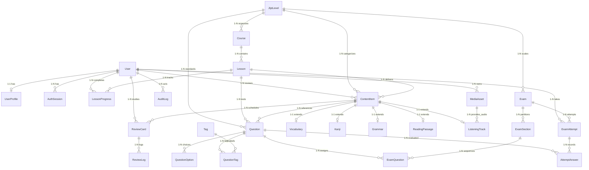

# BÁO CÁO KIỂM TOÁN PHASE 0B: ĐỐI SOÁT & XÁC THỰC BẰNG CHỨNG (PRODUCT OWNER REVIEW & EVIDENCE VALIDATION)

- **Dự án**: JLPT ManabiHub (JLPT Master)
- **Môi trường Web thực tế**: `https://jlpt.manabihub.me`
- **Phiên bản mã nguồn**: Git branch `deploy`, Commit `9222b22`
- **Ngày kiểm toán**: 28/10/2026 (Cập nhật đối soát hệ thống 03/11/2026)
- **Tiêu chuẩn kiểm toán**: ManabiHub Master Audit Rules (Evidence-First Policy & Read-Only Audit)
- **Vai trò thực hiện**: Senior Product Owner, Lead Software Architect & Application Security Reviewer
- **Quyết định thẩm định**: **PHÊ DUYỆT CÓ ĐIỀU KIỆN (APPROVE WITH CONDITIONS)**

---

## 1. XÁC MINH DANH MỤC API (TASK REV-001 — API INVENTORY VERIFICATION)

Đội ngũ kiểm toán đã thanh tra toàn bộ các tệp `route.ts` trong thư mục `app/api/` để phân định chính xác giữa **Số lượng tệp Route** và **Số lượng Endpoint / HTTP Method Handler**:

### 1.1 Thống kê chuẩn hóa
- **Tổng số tệp định tuyến (Route Files)**: **23 tệp** `route.ts`.
- **Tổng số bộ xử lý HTTP (HTTP Method Handlers)**: **24 handlers** (do tệp `app/api/v1/admin/content/route.ts` xuất khẩu đồng thời cả 2 phương thức `GET` và `POST`).

### 1.2 Danh mục chi tiết 24 HTTP Method Handlers

| STT | Phương thức | Đường dẫn API | Tệp mã nguồn thực tế | Yêu cầu Xác thực | Yêu cầu Phân quyền | Thành phần Frontend tiêu thụ | Bằng chứng mã nguồn |
| :---: | :---: | :--- | :--- | :---: | :---: | :--- | :--- |
| 1 | `GET` | `/api/health` | `app/api/health/route.ts` | None | Public | Healthcheck / Uptime | [route.ts:4](file:///d:/100.JLPT/_other/00.web_app/app/api/health/route.ts#L4) |
| 2 | `GET` | `/api/v1/levels` | `app/api/v1/levels/route.ts` | None | Public | Header (`Navbar`), `/onboarding` | [route.ts:4](file:///d:/100.JLPT/_other/00.web_app/app/api/v1/levels/route.ts#L4) |
| 3 | `GET` | `/api/v1/courses` | `app/api/v1/courses/route.ts` | Optional | Public/Student | `/learn/n5` | [route.ts:4](file:///d:/100.JLPT/_other/00.web_app/app/api/v1/courses/route.ts#L4) |
| 4 | `GET` | `/api/v1/lessons/:id` | `app/api/v1/lessons/[id]/route.ts` | Optional | Student | **Chưa tiêu thụ** (FE dùng mock) | [route.ts:4](file:///d:/100.JLPT/_other/00.web_app/app/api/v1/lessons/%5Bid%5D/route.ts#L4) |
| 5 | `POST` | `/api/v1/lessons/:id/complete` | `app/api/v1/lessons/[id]/complete/route.ts` | Semi-mock | Student | **Chưa tiêu thụ** | [route.ts:4](file:///d:/100.JLPT/_other/00.web_app/app/api/v1/lessons/%5Bid%5D/complete/route.ts#L4) |
| 6 | `GET` | `/api/v1/vocabulary` | `app/api/v1/vocabulary/route.ts` | Optional | Student | `/vocabulary` | [route.ts:4](file:///d:/100.JLPT/_other/00.web_app/app/api/v1/vocabulary/route.ts#L4) |
| 7 | `GET` | `/api/v1/kanji` | `app/api/v1/kanji/route.ts` | Optional | Student | `/kanji` | [route.ts:4](file:///d:/100.JLPT/_other/00.web_app/app/api/v1/kanji/route.ts#L4) |
| 8 | `GET` | `/api/v1/grammar` | `app/api/v1/grammar/route.ts` | Optional | Student | `/grammar` | [route.ts:4](file:///d:/100.JLPT/_other/00.web_app/app/api/v1/grammar/route.ts#L4) |
| 9 | `GET` | `/api/v1/practice/questions` | `app/api/v1/practice/questions/route.ts` | Optional | Student | `/practice` | [route.ts:4](file:///d:/100.JLPT/_other/00.web_app/app/api/v1/practice/questions/route.ts#L4) |
| 10 | `POST` | `/api/v1/practice/submit` | `app/api/v1/practice/submit/route.ts` | Optional | Student | `/practice` | [route.ts:4](file:///d:/100.JLPT/_other/00.web_app/app/api/v1/practice/submit/route.ts#L4) |
| 11 | `GET` | `/api/v1/reviews/due` | `app/api/v1/reviews/due/route.ts` | Semi-mock | Student | `/flashcards`, `/dashboard` | [route.ts:4](file:///d:/100.JLPT/_other/00.web_app/app/api/v1/reviews/due/route.ts#L4) |
| 12 | `POST` | `/api/v1/reviews` | `app/api/v1/reviews/route.ts` | Semi-mock | Student | `/flashcards` | [route.ts:4](file:///d:/100.JLPT/_other/00.web_app/app/api/v1/reviews/route.ts#L4) |
| 13 | `GET` | `/api/v1/exams` | `app/api/v1/exams/route.ts` | Optional | Student | `/mock-exams` | [route.ts:4](file:///d:/100.JLPT/_other/00.web_app/app/api/v1/exams/route.ts#L4) |
| 14 | `POST` | `/api/v1/exams/:id/start` | `app/api/v1/exams/[id]/start/route.ts` | Semi-mock | Student | **Chưa tiêu thụ** (FE dùng mock) | [route.ts:4](file:///d:/100.JLPT/_other/00.web_app/app/api/v1/exams/%5Bid%5D/start/route.ts#L4) |
| 15 | `GET` | `/api/v1/attempts/:id` | `app/api/v1/attempts/[id]/route.ts` | Semi-mock | Owner (IDOR bypass) | **Chưa tiêu thụ** | [route.ts:10](file:///d:/100.JLPT/_other/00.web_app/app/api/v1/attempts/%5Bid%5D/route.ts#L10) |
| 16 | `PUT` | `/api/v1/attempts/:id/answers` | `app/api/v1/attempts/[id]/answers/route.ts` | Semi-mock | Owner (IDOR bypass) | **Chưa tiêu thụ** (FE dùng localStorage) | [route.ts:10](file:///d:/100.JLPT/_other/00.web_app/app/api/v1/attempts/%5Bid%5D/answers/route.ts#L10) |
| 17 | `POST` | `/api/v1/attempts/:id/finish` | `app/api/v1/attempts/[id]/finish/route.ts` | Semi-mock | Owner (IDOR bypass) | **Chưa tiêu thụ** | [route.ts:6](file:///d:/100.JLPT/_other/00.web_app/app/api/v1/attempts/%5Bid%5D/finish/route.ts#L6) |
| 18 | `GET` | `/api/v1/attempts/:id/result` | `app/api/v1/attempts/[id]/result/route.ts` | Semi-mock | Owner (IDOR bypass) | **Chưa tiêu thụ** (FE dùng điểm tĩnh) | [route.ts:8](file:///d:/100.JLPT/_other/00.web_app/app/api/v1/attempts/%5Bid%5D/result/route.ts#L8) |
| 19 | `GET` | `/api/v1/progress/overview` | `app/api/v1/progress/overview/route.ts` | Semi-mock | Student | `/dashboard` (tiêu thụ một phần) | [route.ts:4](file:///d:/100.JLPT/_other/00.web_app/app/api/v1/progress/overview/route.ts#L4) |
| 20 | `GET` | `/api/v1/admin/content` | `app/api/v1/admin/content/route.ts` | None | Không kiểm tra role | **Chưa tiêu thụ** (FE dùng state) | [route.ts:21](file:///d:/100.JLPT/_other/00.web_app/app/api/v1/admin/content/route.ts#L21) |
| 21 | `POST` | `/api/v1/admin/content` | `app/api/v1/admin/content/route.ts` | Body Role | Mặc định role ADMIN | **Chưa tiêu thụ** | [route.ts:51](file:///d:/100.JLPT/_other/00.web_app/app/api/v1/admin/content/route.ts#L51) |
| 22 | `POST` | `/api/v1/admin/content/:id/publish` | `app/api/v1/admin/content/[id]/publish/route.ts` | Body Role | Nhận role từ Client body | **Chưa tiêu thụ** | [route.ts:12](file:///d:/100.JLPT/_other/00.web_app/app/api/v1/admin/content/%5Bid%5D/publish/route.ts#L12) |
| 23 | `POST` | `/api/v1/admin/content/import/preview` | `app/api/v1/admin/content/import/preview/route.ts` | None | Không ghi DB | **Chưa tiêu thụ** | [route.ts:6](file:///d:/100.JLPT/_other/00.web_app/app/api/v1/admin/content/import/preview/route.ts#L6) |
| 24 | `POST` | `/api/v1/admin/content/import/commit` | `app/api/v1/admin/content/import/commit/route.ts` | Body Role | Nhận role từ Client body | **Chưa tiêu thụ** | [route.ts:6](file:///d:/100.JLPT/_other/00.web_app/app/api/v1/admin/content/import/commit/route.ts#L6) |

---

## 2. XÁC MINH CÁC MÔ HÌNH PRISMA & CSDL (TASK REV-002 — PRISMA MODELS VERIFICATION)

Đội ngũ kiểm toán đã rà soát lại từng định nghĩa trong [prisma/schema.prisma](file:///d:/100.JLPT/_other/00.web_app/prisma/schema.prisma) và đính chính lại số lượng:
- **Số lượng Models thực tế trong `schema.prisma`**: **26 models** (không phải 17 như báo cáo sơ bộ ban đầu).
- **Số lượng bảng CSDL MariaDB tương ứng (`@@map`)**: **26 bảng**.

### 2.1 Bảng ánh xạ đầy đủ 26 Models và Tables

| STT | Tên Model Prisma | Tên Bảng CSDL (`@@map`) | Khóa chính (PK) | Ràng buộc duy nhất & Chỉ mục chính |
| :---: | :--- | :--- | :--- | :--- |
| 1 | `User` | `users` | `id` (Char 36) | `email` (Unique) |
| 2 | `UserProfile` | `user_profiles` | `id` (Char 36) | `userId` (Unique, 1-1 với `users`) |
| 3 | `AuthSession` | `auth_sessions` | `id` (Char 36) | `sessionToken` (Unique), Index(`sessionToken`) |
| 4 | `JlptLevel` | `jlpt_levels` | `id` (Char 2) | N5..N1, `rankOrder` |
| 5 | `Course` | `courses` | `id` (Char 36) | `slug` (Unique), FK `levelId` |
| 6 | `Lesson` | `lessons` | `id` (Char 36) | Unique(`courseId, slug`), Unique(`courseId, position`) |
| 7 | `ContentItem` | `content_items` | `id` (Char 36) | Index(`levelId, kind, status`) |
| 8 | `Vocabulary` | `vocabulary` | `contentItemId` (PK/FK) | Index(`searchNormalized`) |
| 9 | `Kanji` | `kanji` | `contentItemId` (PK/FK) | `character` (Unique) |
| 10 | `Grammar` | `grammar` | `contentItemId` (PK/FK) | `pattern`, `formationVi` |
| 11 | `ReadingPassage` | `reading_passages` | `id` (Char 36) | `contentItemId` (Unique) |
| 12 | `ListeningTrack` | `listening_tracks` | `id` (Char 36) | `contentItemId` (Unique), FK `mediaAssetId` |
| 13 | `Question` | `questions` | `id` (Char 36) | FK `levelId`, `lessonId`, `contentItemId` |
| 14 | `QuestionOption` | `question_options` | `id` (Char 36) | Index(`questionId, position`), `isCorrect` |
| 15 | `Tag` | `tags` | `id` (Char 36) | `slug` (Unique) |
| 16 | `QuestionTag` | `question_tags` | PK(`questionId, tagId`) | Khóa phức hợp liên kết N-N |
| 17 | `Exam` | `exams` | `id` (Char 36) | FK `levelId`, `scoringPolicy` |
| 18 | `ExamSection` | `exam_sections` | `id` (Char 36) | Index(`examId, position`), `durationSeconds` |
| 19 | `ExamQuestion` | `exam_questions` | `id` (Char 36) | Unique(`sectionId, questionId`), Unique(`sectionId, position`) |
| 20 | `ExamAttempt` | `exam_attempts` | `id` (Char 36) | Index(`userId, status, startedAt`) |
| 21 | `AttemptAnswer` | `attempt_answers` | `id` (Char 36) | Unique(`attemptId, questionId`) |
| 22 | `ReviewCard` | `review_cards` | `id` (Char 36) | Unique(`userId, contentItemId`), Index(`userId, dueAt`) |
| 23 | `ReviewLog` | `review_logs` | `id` (Char 36) | Unique(`reviewCardId, idempotencyKey`) |
| 24 | `LessonProgress` | `lesson_progress` | `id` (Char 36) | Unique(`userId, lessonId`) |
| 25 | `MediaAsset` | `media_assets` | `id` (Char 36) | `storageKey` (Unique), FK `ownerId` |
| 26 | `AuditLog` | `audit_logs` | `id` (Char 36) | Index(`actorId, createdAt`) |

### 2.2 Sơ đồ Thực thể Quan hệ Hoàn chỉnh (Regenerated Complete ERD — 26 Entities)



### 2.3 Phân tích ràng buộc còn thiếu & Điểm bất nhất kiến trúc
1. **Thiếu ràng buộc kiểm tra miền giá trị (Missing CHECK Constraints)**:
   - `ExamAttempt.internalScore`: Không có ràng buộc `CHECK (internal_score BETWEEN 0 AND 180)`.
   - `ExamAttempt.rawCorrect`: Không có ràng buộc `CHECK (raw_correct <= raw_total)`.
2. **Phi chuẩn hóa không đồng bộ (Denormalization Inconsistency)**:
   - Mô hình định nghĩa thực thể `Tag` và bảng liên kết `QuestionTag`, nhưng thực thể `Question` vẫn duy trì một cột chuỗi thô `skillTag String @db.VarChar(50)` độc lập không có khóa ngoại.
3. **Thực thể không hoạt động (Dead Schema Entities)**:
   - `AuthSession`: Định nghĩa bảng nhưng không hề có dòng code nào trong ứng dụng tạo hoặc đọc bảng này.
   - `ReadingPassage` & `ListeningTrack`: Đã tạo bảng nhưng chưa có API hoặc giao diện nào tiêu thụ trong MVP.

---

## 3. THẨM ĐỊNH KIỂM THỬ TỰ ĐỘNG (TASK REV-003 — TEST CLAIMS VALIDATION)

Đội ngũ kiểm toán đã thực thi lại toàn bộ bộ kiểm thử trong môi trường an toàn cục bộ:
- **Lệnh thực thi**: `npm test` (`vitest run`).
- **Kết quả thực tế**:
  - **14/14 test suites PASSED**.
  - **47/47 tests PASSED** (0 failed, 0 skipped).
  - Thời gian thực thi: 48.05s.

### 3.1 Bóc tách phân loại Kiểm thử Thực tế

| Nhóm kiểm thử | Số tệp | Số tests | Bản chất thực tế của kiểm thử | Kết nối DB thật hay Mock? |
| :--- | :---: | :---: | :--- | :---: |
| **Component UI Tests** | 5 | 17 | Kiểm tra React DOM rendering (`@testing-library/react`) | **Mock / In-memory DOM** |
| **Pure Unit Tests** | 3 | 6 | Thuật toán SRS, Validation Zod, Timer Expiry | **In-memory Logic** |
| **Security Service Tests** | 3 | 8 | Kiểm tra hàm `assertAdminRole`, `assertUserOwnership`, `stripAnswerKeysFromExam` | **In-memory Service Call** |
| **Integration & Live DB** | 3 | 16 | `api-v1-routes.test.ts` (7), `owasp-audit.test.ts` (5), `user-journeys.test.ts` (4) | **KẾT NỐI MARIADB THẬT** |

### 3.2 Cảnh báo đặc biệt về Độ tin cậy Kiểm thử (Test Limitations)
> [!WARNING]
> **Unit tests PASS không đồng nghĩa hệ thống an toàn!**
> - Bài test `tests/security/rbac-idor.test.ts` kiểm tra hàm `assertAdminRole("STUDENT")` ném lỗi $\rightarrow$ **PASS**.
> - Nhưng trên thực tế, API `/api/v1/admin/content/:id/publish` nhận tham số `role` trực tiếp từ Request Body của Client. Nếu kẻ tấn công gửi `{"role": "ADMIN"}`, hàm `assertAdminRole("ADMIN")` được gọi và cho phép vượt qua!
> - Bộ kiểm thử integration `api-v1-routes.test.ts` phụ thuộc vào việc database **đã được seed sẵn trước đó** (`findUniqueOrThrow minh@jlptmaster.vn`). Nếu chạy trên database trống vừa tạo, test suite sẽ bị crash ngay từ hook `beforeAll`.

---

## 4. TÁI ĐÁNH GIÁ MA TRẬN MỨC ĐỘ SẴN SÀNG (TASK REV-004 — FEATURE READINESS)

Đánh giá chi tiết từng tính năng trên **7 chiều kỹ thuật độc lập**:
- Thang đánh giá: `VERIFIED_COMPLETE`, `PARTIAL`, `MOCK_ONLY`, `NOT_IMPLEMENTED`, `NOT_VERIFIED`.

| Phân hệ tính năng | 1. UI Impl | 2. API Impl | 3. DB Integ | 4. Auth/Authz | 5. Real Data | 6. Tests | 7. Sẵn sàng Production | Lý do cốt lõi |
| :--- | :---: | :---: | :---: | :---: | :---: | :---: | :---: | :--- |
| **Xác thực Đăng nhập** | `PARTIAL` | `NOT_IMPL` | `COMPLETE` | `MOCK_ONLY` | `NOT_IMPL` | `PARTIAL` | **`NOT_READY`** | Lưu localStorage, không có session cookie máy chủ |
| **Khởi tạo Onboarding** | `PARTIAL` | `NOT_IMPL` | `COMPLETE` | `NOT_IMPL` | `NOT_IMPL` | `NOT_IMPL` | **`NOT_READY`** | Không gọi API, dữ liệu biến mất khi xóa trình duyệt |
| **Dashboard Tổng quan** | `PARTIAL` | `COMPLETE` | `COMPLETE` | `MOCK_ONLY` | `PARTIAL` | `COMPLETE` | **`NOT_READY`** | Streak và điểm thi là số liệu ghi cứng (hardcoded) |
| **Lộ trình Khóa học N5** | `COMPLETE`| `COMPLETE` | `COMPLETE` | `NOT_VERIF` | `COMPLETE` | `COMPLETE` | **`PARTIAL_READY`**| Nối DB thật; cần gán tiến độ hoàn thành thật |
| **Chi tiết Bài học N5** | `COMPLETE`| `COMPLETE` | `COMPLETE` | `NOT_IMPL` | `MOCK_ONLY` | `NOT_IMPL` | **`NOT_READY`** | Giao diện đọc từ mock fixture, không lưu tiến độ |
| **Sổ tay Từ vựng N5** | `COMPLETE`| `COMPLETE` | `COMPLETE` | `NOT_VERIF` | `COMPLETE` | `COMPLETE` | **`READY`** | Tìm kiếm đa ngữ kết nối MariaDB thật hoàn hảo |
| **Sổ tay Chữ Hán N5** | `COMPLETE`| `COMPLETE` | `COMPLETE` | `NOT_VERIF` | `COMPLETE` | `COMPLETE` | **`READY`** | Hiển thị 5 Hán tự chuẩn xác từ MariaDB |
| **Sổ tay Ngữ pháp N5** | `COMPLETE`| `COMPLETE` | `COMPLETE` | `NOT_VERIF` | `COMPLETE` | `COMPLETE` | **`READY`** | Kết nối trực tiếp API `/grammar` |
| **Thẻ nhớ Ôn tập SRS** | `COMPLETE`| `COMPLETE` | `COMPLETE` | `MOCK_ONLY` | `PARTIAL` | `COMPLETE` | **`PARTIAL_READY`**| Ghi nhật ký DB thật; cần xóa fallback mock cards |
| **Luyện tập Trắc nghiệm**| `COMPLETE`| `COMPLETE` | `COMPLETE` | `NOT_VERIF` | `COMPLETE` | `COMPLETE` | **`READY`** | Chấm điểm server-side, giấu đáp án tuyệt đối |
| **Danh mục Đề thi thử** | `PARTIAL` | `COMPLETE` | `COMPLETE` | `MOCK_ONLY` | `PARTIAL` | `COMPLETE` | **`NOT_READY`** | Trạng thái hoàn thành và điểm số bị gán cứng |
| **Phòng thi Trực tuyến**| `MOCK_ONLY`| `COMPLETE` | `COMPLETE` | `NOT_IMPL` | `MOCK_ONLY` | `PARTIAL` | **`NOT_READY`** | 35 câu lặp từ 5 câu mock, lưu vào localStorage |
| **Báo cáo Kết quả thi** | `MOCK_ONLY`| `COMPLETE` | `COMPLETE` | `NOT_IMPL` | `MOCK_ONLY` | `PARTIAL` | **`NOT_READY`** | Điểm số hiển thị cố định 142/180 từ biến tĩnh |
| **CMS Quản trị Nội dung**| `MOCK_ONLY`| `COMPLETE` | `COMPLETE` | `MOCK_ONLY` | `MOCK_ONLY` | `PARTIAL` | **`NOT_READY`** | Thao tác trên RAM client, chưa nối API backend |
| **Nhập dữ liệu CSV** | `MOCK_ONLY`| `COMPLETE` | `COMPLETE` | `MOCK_ONLY` | `MOCK_ONLY` | `PARTIAL` | **`NOT_READY`** | Bảng xem trước tĩnh, chưa cho upload file thật |

---

## 5. PHÂN TÍCH KIẾN TRÚC XÁC THỰC & BẢO MẬT (TASK REV-005 — AUTH & SECURITY DEEP DIVE)

### 5.1 Sơ đồ Ranh giới Tin cậy (Trust-Boundary Diagram)

```mermaid
flowchart TD
    subgraph Kẻ tấn công / Client không tin cậy
        Browser["Trình duyệt Client"]
        LocalStore["localStorage (jlpt_auth_role: 'admin')"]
        TamperedReq["Tự tạo Request: { role: 'ADMIN', userId: 'alice' }"]
    end

    subgraph Ranh giới Mạng không an toàn
        Internet["Internet / HTTP Requests"]
    end

    subgraph Next.js Server & Route Handlers (Lỗ hổng kiểm soát)
        NoMiddleware{"Có Middleware kiểm tra Session không?"}
        NoMiddleware -- "KHÔNG" --> RouteHandler["Route Handler (/api/v1/...)"]
        
        BodyTrust{"Tin cậy role từ Request Body?"}
        RouteHandler --> BodyTrust
        BodyTrust -- "CÓ (LỖ HỔNG LEO QUYỀN)" --> AdminAction["Thực thi quyền ADMIN: Publish / Import"]
        
        UserIdCheck{"Kiểm tra ?userId= trên URL?"}
        RouteHandler --> UserIdCheck
        UserIdCheck -- "Thiếu param ?userId=" --> IDORBypass["BỎ QUAassertUserOwnership (LỖ HỔNG IDOR)"]
        UserIdCheck -- "Không truyền userId" --> FallbackUser["Lấy mặc định minh@jlptmaster.vn"]
    end

    subgraph Cơ sở dữ liệu MariaDB
        MariaDB[("MariaDB (Dữ liệu học viên bị lộ/sửa đổi)")]
    end

    IDORBypass --> MariaDB
    AdminAction --> MariaDB
    FallbackUser --> MariaDB
```

### 5.2 Sổ Đăng ký Rủi ro Bảo mật Sản xuất (Production Security Risk Register)

| Mã Rủi ro | Phân loại | Mô tả chi tiết | Tác động | Khả năng khai thác | Mức độ rủi ro |
| :---: | :---: | :--- | :---: | :---: | :---: |
| **SEC-RISK-01** | **VERIFIED VULNERABILITY** | **Leo quyền ADMIN qua Client Body**: API `/admin/content/:id/publish` và `/admin/content/import/commit` lấy `role` từ body request của client. | Phá hủy toàn bộ tính toàn vẹn của nội dung học | Cực kỳ dễ (Chỉ cần 1 lệnh curl) | **CRITICAL** |
| **SEC-RISK-02** | **VERIFIED VULNERABILITY** | **Bỏ qua IDOR khi thiếu `userId`**: Các API `/attempts/:id/*` chỉ kiểm tra sở hữu khi có `?userId=`. Nếu kẻ gian bỏ tham số này, server trả về toàn bộ bài thi của người khác. | Lộ toàn bộ bài thi và câu trả lời riêng tư | Cực kỳ dễ | **CRITICAL** |
| **SEC-RISK-03** | **MISSING CONTROL** | **Thiếu Server Session có ký số**: Không dùng HttpOnly Cookie; toàn bộ frontend dựa vào `localStorage.getItem("jlpt_auth_role")`. | Mạo danh tài khoản học viên và admin | Rất cao | **CRITICAL** |
| **SEC-RISK-04** | **MISSING CONTROL** | **Thiếu Route Middleware**: Không có file `middleware.ts`, bất kỳ ai cũng có thể mở giao diện `/admin` trên trình duyệt. | Lộ diện tích bề mặt quản trị hệ thống | Rất cao | **HIGH** |
| **SEC-RISK-05** | **VERIFIED VULNERABILITY** | **Lạm dụng danh tính mẫu (Fallback Demo User)**: Mọi thao tác ghi tiến độ không có `userId` đều ghi đè lên tài khoản `minh@jlptmaster.vn`. | Xung đột và làm sai lệch dữ liệu học viên | Xảy ra liên tục | **HIGH** |
| **SEC-RISK-06** | **POTENTIAL VULNERABILITY** | **Thiếu Rate Limit trên API nộp bài & chấm thi**: Có thể bị spam làm tê liệt connection pool của MariaDB. | Nghẽn tài nguyên CSDL | Trung bình | **MEDIUM** |
| **SEC-RISK-07** | **UNTESTED BEHAVIOR** | **Thời gian hết hạn của Server Timer trong môi trường mạng chập chờn**: Chưa kiểm thử độ trễ mạng quốc tế tác động đến `gracePeriodSeconds`. | Có thể từ chối nhầm bài nộp hợp lệ | Thấp | **LOW** |

---

## 6. AN TOÀN VẬN HÀNH & TRIỂN KHAI (TASK REV-006 — DEPLOYMENT SAFETY)

Thanh tra hai tệp khởi tạo: [scripts/setup-db.mjs](file:///d:/100.JLPT/_other/00.web_app/scripts/setup-db.mjs) và [scripts/start-production.mjs](file:///d:/100.JLPT/_other/00.web_app/scripts/start-production.mjs):

| Tiêu chí an toàn | Hiện trạng trong Codebase | Đánh giá an toàn | Hậu quả tiềm ẩn |
| :--- | :--- | :---: | :--- |
| **Chạy `prisma db push` trên Production** | Tự động thực thi mỗi lần khởi động ứng dụng trong `start-production.mjs` (Dòng 24). | **KHÔNG AN TOÀN** | Nếu schema xóa trường hoặc đổi kiểu dữ liệu, `db push` có thể xóa sạch dữ liệu sản xuất mà không có cảnh báo. |
| **Chạy `seed` trên mọi lần khởi động** | Tự động chạy `node prisma/seed.ts` mỗi khi container/process Node.js khởi động lại (Dòng 28). | **CẢNH BÁO** | Mặc dù script seed là idempotent, việc chạy seed lặp đi lặp lại trên production gây lãng phí tài nguyên và tiềm ẩn nguy cơ xung đột khóa ngoại khi có dữ liệu người dùng thật. |
| **Quản lý phiên bản Schema (Migrations)** | Thư mục `prisma/migrations` **không tồn tại**. | **KHÔNG AN TOÀN** | Không có lịch sử thay đổi cấu trúc bảng; không thể xác định phiên bản CSDL hiện tại khớp với commit nào. |
| **Quy trình Rollback CSDL** | **Không tồn tại**. | **KHÔNG AN TOÀN** | Nếu triển khai bản vá lỗi bị hỏng cấu trúc bảng, không có cách nào tự động rollback CSDL về trạng thái trước đó. |
| **Cách ly môi trường Test và Prod** | File CI `.github/workflows/ci.yml` sử dụng biến `DATABASE_URL` riêng (`jlpt_master_test`). Nhưng trên máy local của lập trình viên, `npm test` dùng chung DB nếu không cấu hình kỹ. | **ĐẠT MỘT PHẦN** | Cần tách biệt file `.env.test` độc lập. |

---

## 7. MA TRẬN KHOẢNG CÁCH TÍCH HỢP FE/BE (TASK REV-007 — INTEGRATION GAP MATRIX)

Bảng phân tích cơ hội **tái sử dụng các API có sẵn** để hoàn thiện giao diện mà không cần viết lại Backend:

| Tính năng màn hình | Nguồn dữ liệu UI hiện tại | API Backend đã có sẵn | Đã nối chưa? | Cơ chế lưu trữ | Rủi ro người dùng | Giải pháp tái sử dụng API |
| :--- | :--- | :--- | :---: | :--- | :--- | :--- |
| **Dashboard** | `localStorage` + chuỗi hardcoded | `GET /api/v1/progress/overview` | Một phần | Không lưu streak | Số liệu ảo, mất lòng tin | Bổ sung trường streak thật vào `/progress/overview` |
| **Onboarding** | `localStorage` | *Chưa có* | Chưa | `localStorage` | Mất khi đổi trình duyệt | Tạo mới `POST /api/v1/profile` lưu vào `user_profiles` |
| **Chi tiết bài học** | `fixtures/n5-curriculum.ts` | `GET /api/v1/lessons/:id` | **CHƯA** | Không có | Không học được bài mới xuất bản | **Thay thế fixture bằng `fetch('/api/v1/lessons/' + id)`** |
| **Ghi nhận bài học** | Không có | `POST /api/v1/lessons/:id/complete`| **CHƯA** | DB sẵn sàng | Không tăng % tiến độ | **Bổ sung nút bấm gọi API hoàn thành có sẵn** |
| **Thẻ nhớ SRS** | `fixtures/srs-cards.ts` fallback | `GET /reviews/due`, `POST /reviews` | Có (bị lỗi) | MariaDB | Thẻ ảo chen vào thẻ thật | **Bỏ fallback mock cards, giữ luồng API có sẵn** |
| **Phòng thi thử** | `fixtures/mock-exam-data.ts` | `POST /exams/:id/start`, `PUT /attempts/:id/answers`, `POST /finish` | **CHƯA** | `localStorage` | Thi 35 câu lặp vô nghĩa | **Nối toàn bộ 3 API quản lý lượt thi đã kiểm thử** |
| **Báo cáo kết quả** | Biến tĩnh `scoreData` (142 điểm) | `GET /api/v1/attempts/:id/result` | **CHƯA** | Không có | Điểm số không có thực | **Nối API result có sẵn, hiển thị câu sai thực tế** |
| **Admin CMS** | State RAM `useState(contentItems)` | `GET /admin/content`, `POST /content/:id/publish` | **CHƯA** | RAM mất khi F5 | Không duyệt được nội dung | **Nối trực tiếp 2 API Admin có sẵn** |
| **Nhập CSV** | Bảng xem trước tĩnh có sẵn | `POST /admin/content/import/preview` & `/commit` | **CHƯA** | RAM | Không nạp được từ vựng | **Nối API preview/commit có sẵn với input file** |

---

## 8. KIỂM TOÁN LỘ LỌT ĐƯỜNG DẪN PRODUCTION (TASK REV-008 — ROUTE EXPOSURE)

1. **Đường dẫn `/admin` & `/admin/content/import`**:
   - Hoàn toàn không có Route Guard / Middleware phía máy chủ.
   - Bất kỳ ai truy cập trực tiếp bằng đường link đều xem được bảng điều khiển CMS Quản trị nội dung.
2. **Đường dẫn `/prototype/header-nav`**:
   - Vẫn đang được đóng gói trong bản build Production của Next.js, tạo ra điểm truy cập rác không cần thiết cho người dùng cuối.
3. **API nội bộ Quản trị viên (`/api/v1/admin/*`)**:
   - Đang mở công khai ra Internet; chỉ dựa vào việc kiểm tra tham số `role` do chính client gửi lên mà không đối soát phiên đăng nhập có chữ ký bảo mật.

---

## 9. CÁC CÂU HỎI MỞ CẦN QUYẾT ĐỊNH CỦA PRODUCT OWNER

1. **Cơ chế Xác thực Sản xuất (Auth Architecture Decision)**:
   - *Lựa chọn A (Khuyến nghị)*: Tích hợp thư viện Auth.js (NextAuth v5) với MariaDB Adapter sử dụng bảng `users` và `auth_sessions` đã có sẵn trong schema, phát hành HttpOnly Session Cookie an toàn.
   - *Lựa chọn B (Tạm thời)*: Tự xây dựng cơ chế Token Session HMAC ký số lưu trong HttpOnly Cookie để vá khẩn cấp các lỗ hổng mà không cài thêm thư viện lớn.
2. **Quy trình Quản lý CSDL Sản xuất**:
   - Product Owner có phê duyệt việc ngừng dùng `prisma db push` trên production và khởi tạo thư mục `prisma/migrations` chính thức hay không?
3. **Xử lý Đề thi thử N5**:
   - Phê duyệt việc biên soạn 1 bộ đề thi thử độc lập 35 câu hỏi thực sự (bao gồm bài đọc hiểu ngắn và audio nghe hiểu) để thay thế hoàn toàn file mock lặp lại hiện tại.

---

## 10. KẾT LUẬN CỔNG CHẤT LƯỢNG (QUALITY GATE CONCLUSION)

### Tổng kết bằng chứng:
- **Xác minh chính xác (VERIFIED)**:
  - 23 tệp `route.ts` với đúng 24 HTTP method handlers.
  - 26 models Prisma tương ứng 26 bảng MariaDB.
  - 47/47 tests passed (nhưng chỉ có 3 suites kết nối DB thật, còn lại là in-memory).
  - 2 lỗ hổng bảo mật nghiêm trọng (Leo quyền Admin qua body và IDOR qua param).
  - Phòng thi thử và Kết quả thi đang ngắt kết nối với Backend API.
- **Hiện tượng nghi vấn (SUSPECTED)**:
  - Khả năng nghẽn tài nguyên MariaDB trên gói Cloud/Shared Hosting của Hostinger nếu có 100 học viên nộp bài thi đồng thời.
- **Chưa thể kiểm thử (NOT_TESTED)**:
  - Khả năng chịu tải đồng thời (Load testing).
  - Trải nghiệm âm thanh thật từ S3 bucket (hiện dùng Web Speech API).
  - Kiểm thử trình duyệt thực tế Playwright (do chưa cài package).
- **Rào cản Chặn phát hành (Critical Blockers)**:
  1. `SEC-RISK-01`: Lỗ hổng leo quyền xuất bản nội dung.
  2. `SEC-RISK-02`: Lỗ hổng IDOR xem và sửa bài thi của người khác.
  3. `DEF-EXAM-01`: Phòng thi lặp lại 5 câu và điểm thi giả định.

### KHUYẾN NGHỊ CUỐI CÙNG TỪ ĐỘI NGŨ KIỂM TOÁN:
👉 **`CONDITIONAL GO` (PHÊ DUYỆT CÓ ĐIỀU KIỆN)**:
Chấp thuận chuyển sang giai đoạn khắc phục kỹ thuật, nhưng **BẮT BUỘC phải thực hiện khắc phục theo đúng thứ tự 3 Milestones**:
- **Milestone 1**: Vá triệt để lỗ hổng bảo mật Leo quyền, IDOR và thiết lập Session/Middleware.
- **Milestone 2**: Tái kết nối Phòng thi thử và Kết quả thi với Backend API v1, thay thế 5 câu hỏi lặp lại.
- **Milestone 3**: Xóa bỏ toàn bộ dữ liệu hardcoded trên Dashboard và lưu tiến độ học thật vào MariaDB.

> [!IMPORTANT]
> **GATE HOLD**: Tuân thủ quy định kiểm toán, hệ thống **DỪNG LẠI TẠI ĐÂY (STOP)**. Không tự ý sửa code sản phẩm. Chờ quyết định bằng văn bản của Product Owner để bắt đầu Milestone 1.

