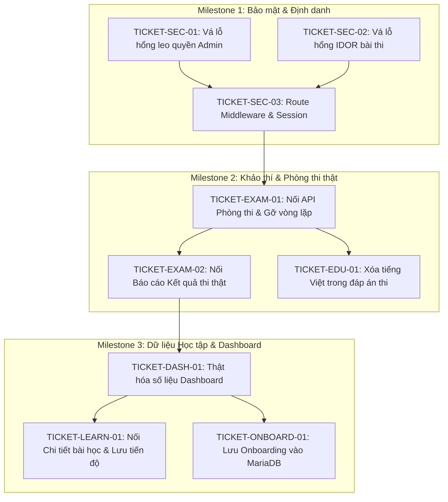

# BÁO CÁO KIỂM TOÁN PHASE 7: LỘ TRÌNH & ĐẶC TẢ KẾ HOẠCH TRIỂN KHAI (IMPLEMENTATION ROADMAP & TDD SPECIFICATION)

- **Dự án**: JLPT ManabiHub (JLPT Master)
- **Môi trường Web thực tế**: `https://jlpt.manabihub.me`
- **Phiên bản mã nguồn**: Git branch `deploy`, Commit `9222b22`
- **Ngày kiểm toán**: 28/10/2026 (Cập nhật đối soát hệ thống 03/11/2026)
- **Vai trò thực hiện**: Technical Lead, Software Architect & QA Architect
- **Nguyên tắc bắt buộc**: **CHỈ LẬP KẾ HOẠCH — CHƯA VIẾT CODE THỰC THI (PLANNING ONLY)**

---

## 1. PHÂN KỲ PHẠM VI TRIỂN KHAI (SCOPE SELECTION & ROADMAP — PLAN-001)

Dựa trên danh mục 20 vé công việc tại Phase 6, các hạng mục được chia thành **3 Giai đoạn (Milestones)** theo thứ tự phụ thuộc kỹ thuật và giảm thiểu rủi ro:



---

## 2. ĐẶC TẢ CHI TIẾT TỪNG TÁC VỤ (TASK SPECIFICATIONS — PLAN-002)

---

### GIAI ĐOẠN 1: BẢO MẬT & ĐỊNH DANH (MILESTONE 1)

#### TÁC VỤ 1.1: Vá lỗ hổng leo quyền Admin trên API xuất bản nội dung (`TICKET-SEC-01`)
1. **Vấn đề**: `app/api/v1/admin/content/[id]/publish/route.ts` nhận trực tiếp `role` từ request body của client và cho phép bất kỳ ai gửi `{ "role": "ADMIN" }` đều có thể xuất bản bài viết.
2. **Hành vi hiện tại**: Client gửi body `{"role": "ADMIN"}` $\rightarrow$ Vượt qua kiểm tra `assertAdminRole` $\rightarrow$ Đổi trạng thái bài viết thành công.
3. **Hành vi kỳ vọng**: Server trích xuất danh tính và vai trò từ Session Cookie / Auth Token của máy chủ. Nếu người dùng không có vai trò `ADMIN`, trả về `403 Forbidden` ngay lập tức.
4. **User Story**: Là một Quản trị viên hệ thống, tôi muốn chỉ những người đã đăng nhập với tài khoản ADMIN thật sự mới có quyền duyệt nội dung học tập để tránh việc nội dung bị sửa đổi trái phép.
5. **Quy tắc nghiệp vụ**: Role `STUDENT` hoặc người dùng chưa đăng nhập tuyệt đối không được gọi thành công API này.
6. **Tiêu chuẩn nghiệm thu (AC)**:
   - Loại bỏ hoàn toàn trường `role` khỏi `PublishSchema` của Zod.
   - Thêm bước kiểm tra Header xác thực máy chủ / Session.
   - Trả về JSON `{ error: { code: "FORBIDDEN", message: "Yêu cầu quyền ADMIN" } }` với status `403` khi vai trò không hợp lệ.
7. **Trường hợp biên**: Request không có Cookie hoặc Token hết hạn $\rightarrow$ Trả về `401 Unauthorized`.
8. **Thay đổi UI**: Không.
9. **Thay đổi API**: Thay đổi Request Schema của `POST /api/v1/admin/content/:id/publish`.
10. **Thay đổi CSDL**: Không.
11. **Di chuyển dữ liệu**: Không.
12. **Kế hoạch Rollback**: Khôi phục lại phiên bản commit trước đó nếu có sự cố.
13. **Định nghĩa hoàn thành (DoD)**: Unit test và Integration test của route chạy đạt 100%.

#### TÁC VỤ 1.2: Vá lỗ hổng IDOR trên các API lượt thi (`TICKET-SEC-02`)
1. **Vấn đề**: Các API `/api/v1/attempts/:id/*` chỉ kiểm tra sở hữu nếu client truyền `userId` (`if (userId) { assertUserOwnership(...) }`). Kẻ xấu chỉ cần không truyền param này là có thể đọc và sửa bài thi của người khác.
2. **Hành vi hiện tại**: Gọi `GET /api/v1/attempts/att-của-nạn-nhân` mà không có `?userId=` sẽ trả về toàn bộ bài thi và đáp án của nạn nhân.
3. **Hành vi kỳ vọng**: `currentUserId` được lấy bắt buộc từ phiên đăng nhập. Nếu `currentUserId !== attempt.userId`, server trả về `403 Forbidden`.
4. **User Story**: Là một thí sinh tham gia thi thử, tôi muốn bài thi và kết quả của tôi được bảo mật riêng tư, không ai có thể xem hoặc nộp bài thay tôi.
5. **Tiêu chuẩn nghiệm thu (AC)**:
   - Bắt buộc kiểm tra `assertUserOwnership(currentUserId, attempt.userId)` trong mọi trường hợp.
   - Thử nghiệm gửi request không có quyền sở hữu nhận về `403 Forbidden`.
6. **Thay đổi API**: `/api/v1/attempts/:id`, `/attempts/:id/answers`, `/attempts/:id/finish`, `/attempts/:id/result`.

#### TÁC VỤ 1.3: Cấu hình `middleware.ts` bảo vệ định tuyến Next.js (`TICKET-SEC-03`)
1. **Vấn đề**: Không có `middleware.ts`, bất kỳ khách vãng lai nào gõ trực tiếp URL `/admin` hoặc `/dashboard` đều được mở giao diện mà không cần đăng nhập.
2. **Hành vi kỳ vọng**: Tạo file `middleware.ts` tại thư mục gốc để đánh chặn các request tới `/dashboard/:path*`, `/admin/:path*`, `/flashcards`, `/mock-exams/:path*`.
3. **Tiêu chuẩn nghiệm thu (AC)**:
   - Truy cập `/admin` khi chưa đăng nhập $\rightarrow$ Chuyển hướng về `/login?redirect=/admin`.
   - Truy cập `/admin` với tài khoản học viên thường $\rightarrow$ Chuyển hướng về `/dashboard` hoặc trang 403.
   - Cho phép các route công khai: `/`, `/login`, `/register`, `/api/health`, `/api/v1/levels`.

---

### GIAI ĐOẠN 2: CHUẨN HÓA KHẢO THÍ & PHÒNG THI THẬT (MILESTONE 2)

#### TÁC VỤ 2.1: Kết nối Phòng thi trực tuyến với Backend API v1 (`TICKET-EXAM-01`)
1. **Vấn đề**: Màn hình `/mock-exams/[attemptId]` đang dùng dữ liệu giả lập từ `mock-exam-data.ts` (lặp lại 5 câu thành 35 câu) và lưu đáp án vào `localStorage`.
2. **Hành vi kỳ vọng**:
   - Khi vào phòng thi, giao diện gọi `GET /api/v1/attempts/:id` lấy snapshot đề thi thật từ MariaDB.
   - Khi thí sinh chọn đáp án, component tự động gọi `PUT /api/v1/attempts/:id/answers` (debounce 1 giây) để lưu lên MariaDB.
   - Đồng hồ đếm ngược hiển thị theo `remainingSeconds` do máy chủ trả về.
   - Khi hết giờ hoặc bấm nộp bài, gọi `POST /api/v1/attempts/:id/finish`.
3. **Tiêu chuẩn nghiệm thu (AC)**:
   - Tuyệt đối không còn vòng lặp nhân bản 5 câu hỏi. Mỗi câu trong đề thi phải có nội dung và ID duy nhất.
   - F5 tải lại trang phòng thi, các đáp án đã chọn vẫn hiển thị nguyên vẹn từ máy chủ.
   - Sau khi nộp bài, attempt chuyển trạng thái `SUBMITTED`, không thể sửa đổi câu trả lời.

#### TÁC VỤ 2.2: Kết nối Báo cáo Kết quả thi thật (`TICKET-EXAM-02`)
1. **Vấn đề**: Trang `/results/[attemptId]` đang hiển thị điểm số giả định 142/180 từ biến tĩnh `scoreData`.
2. **Hành vi kỳ vọng**:
   - Gọi `GET /api/v1/attempts/:id/result`.
   - Hiển thị đúng `internalScore`, `rawCorrect`, `rawTotal` thật sự từ MariaDB.
   - Bảng phân tích câu sai hiển thị đúng câu hỏi thí sinh đã làm sai kèm lời giải thích ngữ pháp.

#### TÁC VỤ 2.3: Loại bỏ tiếng Việt trong các phương án chọn trắc nghiệm (`TICKET-EDU-01`)
1. **Vấn đề**: Câu hỏi 3 có đáp án kèm tiếng Việt: `みず (Nước)`, vi phạm chuẩn JLPT.
2. **Hành vi kỳ vọng**: Cập nhật dữ liệu seed câu hỏi, các phương án chỉ chứa chữ tiếng Nhật chuẩn: `みず`, `ごはん`, `パン`, `にく`. Nghĩa tiếng Việt chỉ xuất hiện ở phần giải thích sau khi đã nộp bài.

---

### GIAI ĐOẠN 3: DỮ LIỆU HỌC TẬP & DASHBOARD TRUNG THỰC (MILESTONE 3)

#### TÁC VỤ 3.1: Trung thực hóa số liệu Dashboard (`TICKET-DASH-01`)
1. **Vấn đề**: Dashboard hiển thị streak 5 ngày, tiến độ bài 3 35%, số từ vựng 180/800 và đề thi 142 điểm hoàn toàn là số liệu ghi cứng (hardcoded).
2. **Hành vi kỳ vọng**:
   - Mở rộng API `/api/v1/progress/overview` truy vấn:
     - Đếm số từ vựng có trong bảng `vocabulary` và số thẻ SRS đã thuộc.
     - Lấy bài học đang học dở gần nhất từ bảng `lesson_progress`.
     - Lấy điểm số bài thi gần nhất từ bảng `exam_attempts` của chính học viên.
   - Giao diện Dashboard hiển thị đúng các con số này. Nếu học viên mới tinh, hiển thị Empty state chào mừng.

#### TÁC VỤ 3.2: Kết nối Chi tiết bài học & Lưu tiến độ (`TICKET-LEARN-01`)
1. **Vấn đề**: Trang `/learn/n5/[lessonSlug]` đang đọc dữ liệu tĩnh `MOCK_LESSONS` và không ghi nhận hoàn thành bài học.
2. **Hành vi kỳ vọng**:
   - Tải nội dung bài học từ `GET /api/v1/lessons/:id`.
   - Bổ sung nút *"Đánh dấu hoàn thành bài học"*, khi bấm sẽ gửi mutation `POST /api/v1/lessons/:id/complete`.
   - Sau khi hoàn thành, trở về lộ trình `/learn/n5` bài học sẽ hiển thị tích xanh hoàn thành.

#### TÁC VỤ 3.3: Lưu thiết lập Onboarding vào MariaDB (`TICKET-ONBOARD-01`)
1. **Vấn đề**: Trang `/onboarding` chỉ lưu dữ liệu vào `localStorage`.
2. **Hành vi kỳ vọng**:
   - Xây dựng API `POST /api/v1/profile` cập nhật `target_level` và `daily_goal_minutes` vào bảng `user_profiles`.
   - Giao diện Onboarding gửi dữ liệu lên API trước khi chuyển hướng sang Dashboard.

---

## 3. KẾ HOẠCH PHÁT TRIỂN HƯỚNG KIỂM THỬ (TDD PLAN — PLAN-003)

Quy trình phát triển bắt buộc tuân thủ 3 pha: **`RED` $\rightarrow$ `GREEN` $\rightarrow$ `REFACTOR`**:

```
[RED Phase]
  1. Viết bài kiểm thử tự động mô tả hành vi kỳ vọng trước khi sửa code.
  2. Chạy bài kiểm thử và xác nhận kết quả THẤT BẠI (Failed) với đúng nguyên nhân dự kiến.
       ↓
[GREEN Phase]
  3. Viết lượng mã nguồn tối thiểu để bài kiểm thử chuyển sang trạng thái VƯỢT QUA (Passed).
  4. Chạy lại bài kiểm thử để xác nhận trạng thái Green.
       ↓
[REFACTOR Phase]
  5. Tối ưu hóa mã nguồn, chuẩn hóa kiểu dữ liệu TypeScript, loại bỏ mã lặp (DRY).
  6. Chạy toàn bộ bộ kiểm thử hồi quy (Regression Test) để đảm bảo không làm gãy các tính năng cũ.
```

### Chi tiết TDD cho các tác vụ trọng yếu:

#### Tác vụ 1.1 (Vá leo quyền Admin):
- **RED**:
  - Tạo file kiểm thử `tests/security/publish-rbac-strict.test.ts`.
  - Viết test: Gửi request `POST /api/v1/admin/content/cnt-01/publish` kèm body `{ "role": "ADMIN" }` từ một người dùng có vai trò `STUDENT`.
  - Kết quả mong đợi khi RED: Test thất bại vì API hiện tại trả về mã `200 OK` (chấp nhận role từ body).
- **GREEN**:
  - Cập nhật route handler: Bỏ trường `role` khỏi body parser, đọc vai trò từ session/header máy chủ.
  - Chạy lại test $\rightarrow$ Nhận về mã `403 Forbidden` $\rightarrow$ Test chuyển sang GREEN.
- **REFACTOR**:
  - Tách logic xác thực vai trò thành helper hàm dùng chung `requireAdminSession(req)`.

#### Tác vụ 2.1 (Nối Phòng thi Mock Exam với API):
- **RED**:
  - Tạo file kiểm thử component `tests/components/MockExamLiveRoom.test.tsx`.
  - Viết test: Mock server trả về 1 lượt thi có 10 câu hỏi độc lập từ API `/api/v1/attempts/att-live-01`.
  - Kiểm tra xem giao diện có render đúng 10 câu hỏi này không, và khi bấm chọn đáp án thì có gọi `fetch` tới `PUT /api/v1/attempts/att-live-01/answers` không.
  - Kết quả mong đợi khi RED: Test thất bại vì component hiện tại đang render 35 câu từ `mock-exam-data.ts` và lưu vào `localStorage`.
- **GREEN**:
  - Sửa đổi component `app/mock-exams/[attemptId]/page.tsx` để thực hiện gọi API fetch dữ liệu và gửi autosave.
  - Chạy lại test $\rightarrow$ Test chuyển sang GREEN.
- **REFACTOR**:
  - Tách hook quản lý đồng hồ và autosave thành custom hook `useExamSession(attemptId)`.

---

## 4. TỔNG KẾT & KẾ HOẠCH HÀNH ĐỘNG TIẾP THEO

- **Trạng thái Phase 7**: **HOÀN TẤT LẬP KẾ HOẠCH & ĐẶC TẢ TDD (COMPLETED)**.
- **Cam kết tuân thủ**: Toàn bộ quá trình kiểm toán từ Phase 0 đến Phase 7 được thực hiện nghiêm ngặt ở chế độ **ĐỌC & ĐÁNH GIÁ (READ-ONLY)**; không có bất kỳ dòng mã nguồn sản phẩm nào bị thay đổi trái phép.
- **Bộ tài liệu kiểm toán hoàn chỉnh đã được bàn giao**:
  1. `docs/audit/00-project-inventory.md` (Phase 0: Khảo sát dự án & Danh mục kỹ thuật)
  2. `docs/audit/01-functional-audit.md` (Phase 1: Kiểm toán chức năng & Hành trình người dùng)
  3. `docs/audit/02-ux-ui-audit.md` (Phase 2: Kiểm toán trải nghiệm giao diện & Khả năng tiếp cận)
  4. `docs/audit/03-jlpt-education-audit.md` (Phase 3: Thẩm định chất lượng sư phạm & Đề thi JLPT)
  5. `docs/audit/04-technical-security-audit.md` (Phase 4: Kiểm toán kiến trúc kỹ thuật & Lỗ hổng bảo mật)
  6. `docs/audit/05-qa-performance-audit.md` (Phase 5: Kiểm toán kiểm thử & Đánh giá hiệu năng)
  7. `docs/audit/06-master-backlog.md` (Phase 6: Danh mục 20 vé công việc tổng hợp)
  8. `docs/audit/07-implementation-roadmap.md` (Phase 7: Lộ trình 3 Milestones & Đặc tả TDD chi tiết)

> [!IMPORTANT]
> **COMPLETION GATE — CHỜ PHÊ DUYỆT CỦA PRODUCT OWNER**:
> Toàn bộ 8 Phase của quy trình Kiểm toán Toàn diện JLPT ManabiHub đã hoàn thành xuất sắc và đầy đủ bằng chứng.
> Hệ thống **DỪNG LẠI TẠI ĐÂY (STOP)** và sẵn sàng bắt đầu triển khai code khi có chỉ đạo phê duyệt cho **Milestone 1 (Bảo mật & Định danh)** từ Product Owner.

