# JLPT Master — Navigation Architecture & Design Specification

**Document:** `docs/design/navigation-spec.md`  
**Phase:** Phase 2 & Phase 3 — Information Architecture & Design System (`ui-ux-designer`)  
**Status:** Ready for Prototype Verification & Owner Approval  
**Date:** 2026-10-28  

---

## 1. Navigation Architecture (5 Primary Pillars)

To eliminate cognitive overload and respect Miller's Law ($5 \pm 2$ top-level chunks), the entire JLPT Master learner experience is consolidated into **5 Primary Navigation Sections**:

```mermaid
flowchart TD
    Root["JLPT Master Global Navigation"] --> S1["1. Trang chủ (/dashboard)"]
    Root --> S2["2. Học tập"]
    Root --> S3["3. Luyện tập"]
    Root --> S4["4. Thi thử"]
    Root --> S5["5. Tiến độ"]

    S2 --> S2_1["Lộ trình học (/learn/n5)"]
    S2 --> S2_2["Từ vựng (/vocabulary)"]
    S2 --> S2_3["Kanji (/kanji)"]
    S2 --> S2_4["Ngữ pháp (/grammar)"]
    S2 --> S2_5["Flashcard SRS (/flashcards)"]

    S3 --> S3_1["Trắc nghiệm (/practice)"]
    S3 --> S3_2["Đọc hiểu (/reading)"]
    S3 --> S3_3["Nghe hiểu (/listening)"]
    S3 --> S3_4["Ôn câu sai (/practice?filter=mistakes)"]

    S4 --> S4_1["Danh sách đề (/mock-exams)"]
    S4 --> S4_2["Lịch sử thi (/mock-exams?tab=history)"]
    S4 --> S4_3["Kết quả (/results/att-01)"]

    S5 --> S5_1["Tổng quan (/progress)"]
    S5 --> S5_2["Thống kê (/progress?tab=analytics)"]
    S5 --> S5_3["Thành tích (/progress?tab=achievements)"]
```

### 1.1 Section Mapping & Active Route Rules

| # | Primary Section | Type | Sub-navigation Items | Active State Matcher (`isActive`) |
|---|---|---|---|---|
| **1** | **Trang chủ** | Direct Link | — | `pathname === "/dashboard"` or `pathname === "/"` |
| **2** | **Học tập** | Dropdown / Sheet | • **Lộ trình học** (`/learn/n5`) — *3 bài học N5 chuẩn* • **Từ vựng** (`/vocabulary`) — *Tra cứu đa kịch bản* • **Kanji** (`/kanji`) — *Âm On/Kun & Hán-Việt* • **Ngữ pháp** (`/grammar`) — *Cấu trúc & mẫu câu* • **Flashcard SRS** (`/flashcards`) — *Ôn tập ngắt quãng* | `pathname.startsWith("/learn")` \|\| `pathname.startsWith("/vocabulary")` \|\| `pathname.startsWith("/kanji")` \|\| `pathname.startsWith("/grammar")` \|\| `pathname.startsWith("/flashcards")` |
| **3** | **Luyện tập** | Dropdown / Sheet | • **Trắc nghiệm** (`/practice`) — *Chấm điểm tức thì* • **Đọc hiểu** (`/reading`) — *Đoạn văn ngắn N5* • **Nghe hiểu** (`/listening`) — *Luyện nghe hội thoại* • **Ôn câu sai** (`/practice?mode=mistakes`) — *Khắc phục điểm yếu* | `pathname.startsWith("/practice")` \|\| `pathname.startsWith("/reading")` \|\| `pathname.startsWith("/listening")` |
| **4** | **Thi thử** | Dropdown / Sheet | • **Danh sách đề** (`/mock-exams`) — *Đề chuẩn bấm giờ* • **Lịch sử thi** (`/mock-exams?view=history`) — *Các lượt đã làm* • **Kết quả** (`/results/att-01`) — *Phân tích điểm 0–180* | `pathname.startsWith("/mock-exams")` \|\| `pathname.startsWith("/results")` |
| **5** | **Tiến độ** | Dropdown / Sheet | • **Tổng quan** (`/progress`) — *Chuỗi ngày học & Mục tiêu* • **Thống kê** (`/progress?view=stats`) — *Biểu đồ kỹ năng* • **Thành tích** (`/progress?view=badges`) — *Cột mốc JLPT* | `pathname.startsWith("/progress")` |

---

## 2. Header Utility Controls & Role-Based Visibility

### 2.1 JLPT Level Selector (`N5`–`N1`)
- Positioned cleanly to the right of the Brand identity (or in the right utility cluster on compact viewports).
- Displays current target level: **`JLPT N5`** with a subtle vermilion indicator dot.
- Clicking opens an accessible popover listing all 5 levels:
  - **N5 — Sơ cấp 1:** `Đang học` (Selectable, active `#B9343F` accent).
  - **N4 — Sơ cấp 2:** `Sắp ra mắt` (Muted badge, non-destructive preview info).
  - **N3 — Trung cấp:** `Sắp ra mắt`.
  - **N2 — Trung-Cao cấp:** `Sắp ra mắt`.
  - **N1 — Cao cấp:** `Sắp ra mắt`.

### 2.2 Role-Based Right Utility Zone

| User Role | Visible Utility Controls | Admin Access Visibility |
|---|---|---|
| **Guest (`GUEST`)** | • JLPT Level Selector (`N5`) • **Đăng nhập** (Ghost/Outline button, `44px` height) • **Đăng ký học** (Primary `#B9343F` CTA button, `44px` height) | **Hidden** (Strictly invisible) |
| **Student (`STUDENT`)** | • JLPT Level Selector (`N5`) • **Notifications Bell** (with unread badge e.g. `8 thẻ SRS đến hạn`) • **User Avatar Menu** (`Minh Nguyễn`, target `N5`, links to `Hồ sơ`, `Cài đặt`, `Đăng xuất`) | **Hidden** (Strictly invisible) |
| **Administrator (`ADMIN`)** | • JLPT Level Selector (`N5`) • **Admin CMS Quick Pill** (`Quản trị CMS` $\rightarrow$ `/admin`) • **Notifications Bell** • **User Avatar Menu** (includes `Quản trị nội dung`, `Nhập CSV`, `Nhật ký hệ thống`) | **Visible** (Dedicated indigo badge & menu section) |

### 2.3 Contextual Furigana Control (Removed from Global Header)
- **Rule:** The global header **no longer contains** the `振 Furigana: BẬT/TẮT` button.
- **New Location:** Placed inside a dedicated **Contextual Learning Bar** rendered at the top of study content containers (`/learn/*`, `/vocabulary`, `/kanji`, `/grammar`, `/flashcards`), right next to Japanese text where learners actually toggle ruby annotations.

---

## 3. Design System & Visual Tokens (Japanese Minimal Educational Aesthetic)

### 3.1 Color Tokens
| Token | Hex | Application in Navigation |
|---|---|---|
| **Primary Vermilion** | `#B9343F` | Brand seal `日`, active bottom border/indicator, primary CTA, active icon stroke |
| **Primary Hover** | `#A02731` | Primary CTA hover state |
| **Primary Subtle** | `#FBEBEB` | Active nav item pill background (`bg-[#FBEBEB]`), active dropdown item tint |
| **Charcoal Text** | `#1F2937` | Primary nav labels, dropdown titles (`font-medium` / `font-semibold`) |
| **Muted Slate** | `#6B7280` | Dropdown item helper descriptions, inactive mobile tab icons |
| **Warm Paper Canvas** | `#F7F7F4` | Page background below header; subtle secondary surface |
| **Pure Surface** | `#FFFFFF` | Header bar (`bg-white/95 backdrop-blur-sm`), dropdown panels, bottom nav |
| **Structural Border** | `#E5E7EB` | `1px solid` bottom header border and dropdown card hairline border |

### 3.2 Typography & Spacing
- **Vietnamese UI Font:** `Be Vietnam Pro` (`14px` / `0.875rem` for desktop nav items, `600` weight for active, `500` for default; `11px` for mobile bottom nav labels).
- **Japanese Accent Font:** `Noto Sans JP` for the `日` brand emblem and level badges.
- **Header Height:** `64px` (`h-16`) on Desktop (`≥1024px`), `56px` (`h-14`) on Mobile (`<768px`).
- **Touch Targets:** All top-level nav triggers, dropdown links, notification buttons, level selector, and mobile bottom nav tabs enforce a minimum hit area of **`44×44px`**.

---

## 4. Responsive Behavior Across Breakpoints

| Viewport Width | Device Class | Navigation Layout & Behavior |
|---|---|---|
| **375px** | Mobile Portrait | • **Top Header (`56px`):** Compact Brand logo + Level Selector (`N5`) + Notification Bell + Avatar. • **Fixed Bottom Nav (`64px` + `env(safe-area-inset-bottom)`):** 5 primary tabs (`Trang chủ`, `Học tập`, `Luyện tập`, `Thi thử`, `Tiến độ`). • Tapping a tab with sub-items opens a clean **Mobile Bottom Sheet** with 48px-tall touch rows for sub-routes. |
| **768px** | Tablet | • **Top Header (`64px`):** Brand logo + 5 horizontal compact primary items (with dropdowns) + Level Selector + Avatar Menu. Bottom Nav is hidden (`md:hidden`) or cleanly transitions at `lg:` depending on width. To guarantee zero crowding at `768px`, primary horizontal desktop nav activates at `lg:` (`1024px`) while `768px` uses the clean Bottom Nav + Sheet or compact bar without subtitle overflow. *In our responsive spec, `768px` displays the full 5 primary items cleanly in the top bar by hiding the brand subtitle until `xl:` (`1280px`).* |
| **1280px** | Standard Laptop | • **Top Header (`64px`):** Full Brand logo with subtitle + Level Selector + centered 5 Primary Sections with rich dropdown panels + Right Utility Bar (Notifications, Avatar, Admin badge if Admin). |
| **1440px** | Wide Desktop | • Max-width `1280px` (`max-w-7xl`) centered container with generous `24px–32px` horizontal padding and balanced 3-zone grid (Brand+Level left, 5 Pillars center, Account/Notifications right). |

---

## 5. Accessibility & Keyboard Interaction Spec (WCAG 2.2 AA)

1. **Semantic Landmarks:**
   - Top header wrapped in `<header>` containing `<nav aria-label="Điều hướng chính">`.
   - Mobile bottom bar wrapped in `<nav aria-label="Điều hướng di động">`.
2. **Dropdown ARIA Attributes:**
   - Trigger buttons include `aria-expanded="true|false"`, `aria-haspopup="true"`, and `aria-controls="menu-[id]"`.
   - Active section and active sub-link include `aria-current="page"`.
3. **Keyboard Controls:**
   - `Tab` / `Shift+Tab`: Moves focus sequentially across Brand, Level Selector, the 5 primary triggers, and Utility controls with visible `focus-visible:ring-2 focus-visible:ring-[#B9343F] focus-visible:ring-offset-2`.
   - `Enter` / `Space` / `ArrowDown`: Opens the focused section's dropdown menu and focuses the first item.
   - `Escape`: Immediately closes any open dropdown, notification popover, level selector, or mobile bottom sheet and returns focus to its trigger button.

