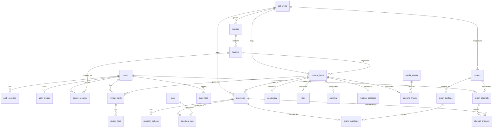

# JLPT Master — Entity-Relationship Diagram & MariaDB Schema Specification

**Document:** `docs/erd.md`  
**Phase:** 4 — API & Database Architecture (`api-db-architect`)  
**Status:** Under Review (Gate Approval Required)  
**Target Engine:** MariaDB 10.11+ (InnoDB Engine, `utf8mb4` Character Set, `utf8mb4_unicode_ci` Collation)  

---

## 1. Complete Entity-Relationship Diagram (Mermaid ERD)

---

## 2. Table Schemas, Types & Constraints

### 2.1 Identity & Profile Subdomain
- **`users`**
  - `id`: `CHAR(36)` PK (UUID v4)
  - `email`: `VARCHAR(191)` UNIQUE NOT NULL
  - `password_hash`: `VARCHAR(255)` NULL (For credential auth; nullable for future OAuth)
  - `role`: `ENUM('STUDENT', 'EDITOR', 'ADMIN')` NOT NULL DEFAULT `'STUDENT'`
  - `status`: `ENUM('ACTIVE', 'SUSPENDED', 'PENDING_VERIFICATION')` NOT NULL DEFAULT `'ACTIVE'`
  - `created_at`: `DATETIME(3)` NOT NULL DEFAULT CURRENT_TIMESTAMP(3)
  - `updated_at`: `DATETIME(3)` NOT NULL DEFAULT CURRENT_TIMESTAMP(3) ON UPDATE CURRENT_TIMESTAMP(3)
  - *Indexes:* `INDEX idx_users_email (email)`, `INDEX idx_users_role (role)`
- **`user_profiles`**
  - `id`: `CHAR(36)` PK
  - `user_id`: `CHAR(36)` UNIQUE NOT NULL, FK $\rightarrow$ `users(id)` ON DELETE CASCADE
  - `target_level`: `CHAR(2)` NOT NULL DEFAULT `'N5'`
  - `daily_goal_minutes`: `INT` NOT NULL DEFAULT 30
  - `timezone`: `VARCHAR(50)` NOT NULL DEFAULT `'Asia/Ho_Chi_Minh'`
  - `onboarding_completed_at`: `DATETIME(3)` NULL
- **`auth_sessions`**
  - `id`: `CHAR(36)` PK
  - `user_id`: `CHAR(36)` NOT NULL, FK $\rightarrow$ `users(id)` ON DELETE CASCADE
  - `session_token`: `VARCHAR(191)` UNIQUE NOT NULL
  - `expires_at`: `DATETIME(3)` NOT NULL
  - *Indexes:* `INDEX idx_sessions_token (session_token)`

### 2.2 Curriculum & Learning Content Subdomain
- **`jlpt_levels`**
  - `id`: `CHAR(2)` PK (e.g., `'N5'`, `'N4'`, `'N3'`, `'N2'`, `'N1'`)
  - `name_vi`: `VARCHAR(50)` NOT NULL
  - `rank_order`: `INT` NOT NULL
  - `is_active`: `BOOLEAN` NOT NULL DEFAULT FALSE (Only N5 is TRUE in MVP)
- **`courses`**
  - `id`: `CHAR(36)` PK
  - `level_id`: `CHAR(2)` NOT NULL, FK $\rightarrow$ `jlpt_levels(id)`
  - `slug`: `VARCHAR(100)` UNIQUE NOT NULL
  - `title_vi`: `VARCHAR(191)` NOT NULL
  - `description_vi`: `TEXT` NOT NULL
  - `status`: `ENUM('DRAFT', 'IN_REVIEW', 'PUBLISHED', 'ARCHIVED')` NOT NULL DEFAULT `'DRAFT'`
  - `version`: `VARCHAR(20)` NOT NULL DEFAULT `'v1.0'`
  - `published_at`: `DATETIME(3)` NULL
- **`lessons`**
  - `id`: `CHAR(36)` PK
  - `course_id`: `CHAR(36)` NOT NULL, FK $\rightarrow$ `courses(id)` ON DELETE CASCADE
  - `slug`: `VARCHAR(100)` NOT NULL
  - `title_vi`: `VARCHAR(191)` NOT NULL
  - `position`: `INT` NOT NULL
  - `minutes_estimate`: `INT` NOT NULL DEFAULT 30
  - `status`: `ENUM('DRAFT', 'IN_REVIEW', 'PUBLISHED', 'ARCHIVED')` NOT NULL DEFAULT `'DRAFT'`
  - `published_at`: `DATETIME(3)` NULL
  - *Constraints:* `UNIQUE(course_id, slug)`, `UNIQUE(course_id, position)`
- **`content_items`**
  - `id`: `CHAR(36)` PK
  - `lesson_id`: `CHAR(36)` NULL, FK $\rightarrow$ `lessons(id)` ON DELETE SET NULL
  - `level_id`: `CHAR(2)` NOT NULL, FK $\rightarrow$ `jlpt_levels(id)`
  - `kind`: `ENUM('VOCAB', 'KANJI', 'GRAMMAR', 'KANA', 'READING', 'LISTENING')` NOT NULL
  - `slug`: `VARCHAR(100)` NOT NULL
  - `status`: `ENUM('DRAFT', 'IN_REVIEW', 'PUBLISHED', 'ARCHIVED')` NOT NULL DEFAULT `'DRAFT'`
  - `reviewer_id`: `CHAR(36)` NULL, FK $\rightarrow$ `users(id)`
  - `published_at`: `DATETIME(3)` NULL
  - `version`: `VARCHAR(20)` NOT NULL DEFAULT `'v1.0'`
  - *Indexes:* `INDEX idx_content_level_kind_status (level_id, kind, status)`
- **`vocabulary`**
  - `content_item_id`: `CHAR(36)` PK, FK $\rightarrow$ `content_items(id)` ON DELETE CASCADE
  - `surface`: `VARCHAR(100)` NOT NULL
  - `reading`: `VARCHAR(100)` NOT NULL
  - `meaning_vi`: `VARCHAR(255)` NOT NULL
  - `pos`: `VARCHAR(50)` NOT NULL
  - `example_ja`: `TEXT` NOT NULL
  - `example_reading`: `TEXT` NOT NULL
  - `example_vi`: `TEXT` NOT NULL
  - `search_normalized`: `VARCHAR(255)` NOT NULL
  - *Indexes:* `INDEX idx_vocab_search (search_normalized)`
- **`kanji`**
  - `content_item_id`: `CHAR(36)` PK, FK $\rightarrow$ `content_items(id)` ON DELETE CASCADE
  - `character`: `VARCHAR(10)` UNIQUE NOT NULL
  - `onyomi_json`: `JSON` NOT NULL
  - `kunyomi_json`: `JSON` NOT NULL
  - `han_viet`: `VARCHAR(50)` NOT NULL
  - `meaning_vi`: `VARCHAR(255)` NOT NULL
  - `strokes`: `INT` NOT NULL
  - `examples_json`: `JSON` NOT NULL
- **`grammar`**
  - `content_item_id`: `CHAR(36)` PK, FK $\rightarrow$ `content_items(id)` ON DELETE CASCADE
  - `pattern`: `VARCHAR(191)` NOT NULL
  - `formation_vi`: `TEXT` NOT NULL
  - `meaning_vi`: `TEXT` NOT NULL
  - `explanation_vi`: `TEXT` NOT NULL
  - `examples_json`: `JSON` NOT NULL
  - `nuance_vi`: `TEXT` NOT NULL

### 2.3 Questions & Mock Exam Subdomain
- **`questions`**
  - `id`: `CHAR(36)` PK
  - `level_id`: `CHAR(2)` NOT NULL, FK $\rightarrow$ `jlpt_levels(id)`
  - `lesson_id`: `CHAR(36)` NULL, FK $\rightarrow$ `lessons(id)` ON DELETE SET NULL
  - `content_item_id`: `CHAR(36)` NULL, FK $\rightarrow$ `content_items(id)` ON DELETE SET NULL
  - `question_type`: `ENUM('SINGLE_CHOICE', 'KANJI_READING', 'BLANK_CHOICE', 'STAR_ORDER', 'READING', 'LISTENING')` NOT NULL
  - `prompt_json`: `JSON` NOT NULL
  - `explanation_vi`: `TEXT` NOT NULL
  - `difficulty`: `TINYINT` NOT NULL DEFAULT 1
  - `skill_tag`: `VARCHAR(50)` NOT NULL
  - `status`: `ENUM('DRAFT', 'IN_REVIEW', 'PUBLISHED', 'ARCHIVED')` NOT NULL DEFAULT `'DRAFT'`
  - `version`: `VARCHAR(20)` NOT NULL DEFAULT `'v1.0'`
- **`question_options`**
  - `id`: `CHAR(36)` PK
  - `question_id`: `CHAR(36)` NOT NULL, FK $\rightarrow$ `questions(id)` ON DELETE CASCADE
  - `position`: `TINYINT` NOT NULL
  - `text_json`: `JSON` NOT NULL
  - `is_correct`: `BOOLEAN` NOT NULL
  - *Indexes:* `INDEX idx_qopt_question_pos (question_id, position)`
- **`exams`**
  - `id`: `CHAR(36)` PK
  - `level_id`: `CHAR(2)` NOT NULL, FK $\rightarrow$ `jlpt_levels(id)`
  - `title`: `VARCHAR(191)` NOT NULL
  - `status`: `ENUM('DRAFT', 'IN_REVIEW', 'PUBLISHED', 'ARCHIVED')` NOT NULL DEFAULT `'DRAFT'`
  - `version`: `VARCHAR(20)` NOT NULL DEFAULT `'v1.0'`
  - `scoring_policy`: `VARCHAR(50)` NOT NULL DEFAULT `'JLPT_SCALE_180'`
  - `published_at`: `DATETIME(3)` NULL
- **`exam_sections`**
  - `id`: `CHAR(36)` PK
  - `exam_id`: `CHAR(36)` NOT NULL, FK $\rightarrow$ `exams(id)` ON DELETE CASCADE
  - `section_type`: `ENUM('VOCAB', 'GRAMMAR_READING', 'LISTENING')` NOT NULL
  - `position`: `TINYINT` NOT NULL
  - `duration_seconds`: `INT` NOT NULL
  - `max_internal_points`: `INT` NOT NULL DEFAULT 60
  - *Indexes:* `INDEX idx_exam_sec_position (exam_id, position)`
- **`exam_questions`**
  - `id`: `CHAR(36)` PK
  - `section_id`: `CHAR(36)` NOT NULL, FK $\rightarrow$ `exam_sections(id)` ON DELETE CASCADE
  - `question_id`: `CHAR(36)` NOT NULL, FK $\rightarrow$ `questions(id)` ON DELETE RESTRICT
  - `position`: `INT` NOT NULL
  - `points`: `INT` NOT NULL DEFAULT 1
  - *Constraints:* `UNIQUE(section_id, question_id)`, `UNIQUE(section_id, position)`
- **`exam_attempts`**
  - `id`: `CHAR(36)` PK
  - `exam_id`: `CHAR(36)` NOT NULL, FK $\rightarrow$ `exams(id)` ON DELETE RESTRICT
  - `exam_version`: `VARCHAR(20)` NOT NULL
  - `user_id`: `CHAR(36)` NOT NULL, FK $\rightarrow$ `users(id)` ON DELETE RESTRICT
  - `status`: `ENUM('IN_PROGRESS', 'SUBMITTED', 'EXPIRED', 'ABANDONED')` NOT NULL DEFAULT `'IN_PROGRESS'`
  - `started_at`: `DATETIME(3)` NOT NULL DEFAULT CURRENT_TIMESTAMP(3)
  - `last_saved_at`: `DATETIME(3)` NOT NULL DEFAULT CURRENT_TIMESTAMP(3)
  - `expires_at`: `DATETIME(3)` NOT NULL
  - `submitted_at`: `DATETIME(3)` NULL
  - `raw_correct`: `INT` NULL
  - `raw_total`: `INT` NULL
  - `internal_score`: `INT` NULL
  - `exam_snapshot_json`: `JSON` NOT NULL
  - *Indexes:* `INDEX idx_attempts_user_status (user_id, status, started_at)`
- **`attempt_answers`**
  - `id`: `CHAR(36)` PK
  - `attempt_id`: `CHAR(36)` NOT NULL, FK $\rightarrow$ `exam_attempts(id)` ON DELETE CASCADE
  - `question_id`: `CHAR(36)` NOT NULL, FK $\rightarrow$ `questions(id)` ON DELETE RESTRICT
  - `answer_json`: `JSON` NOT NULL
  - `saved_at`: `DATETIME(3)` NOT NULL DEFAULT CURRENT_TIMESTAMP(3)
  - `is_correct`: `BOOLEAN` NULL
  - *Constraints:* `UNIQUE(attempt_id, question_id)`

### 2.4 Spaced Repetition (SRS) Subdomain
- **`review_cards`**
  - `id`: `CHAR(36)` PK
  - `user_id`: `CHAR(36)` NOT NULL, FK $\rightarrow$ `users(id)` ON DELETE CASCADE
  - `content_item_id`: `CHAR(36)` NOT NULL, FK $\rightarrow$ `content_items(id)` ON DELETE CASCADE
  - `due_at`: `DATETIME(3)` NOT NULL DEFAULT CURRENT_TIMESTAMP(3)
  - `interval_seconds`: `INT` NOT NULL DEFAULT 0
  - `ease_factor`: `DECIMAL(4,2)` NOT NULL DEFAULT 2.50
  - `repetitions`: `INT` NOT NULL DEFAULT 0
  - `lapses`: `INT` NOT NULL DEFAULT 0
  - `scheduler_version`: `VARCHAR(20)` NOT NULL DEFAULT `'SIMPLE_SRS_v1'`
  - *Constraints:* `UNIQUE(user_id, content_item_id)`
  - *Indexes:* `INDEX idx_review_cards_due (user_id, due_at)`
- **`review_logs`**
  - `id`: `CHAR(36)` PK
  - `review_card_id`: `CHAR(36)` NOT NULL, FK $\rightarrow$ `review_cards(id)` ON DELETE CASCADE
  - `idempotency_key`: `CHAR(36)` NOT NULL
  - `grade`: `ENUM('AGAIN', 'HARD', 'GOOD', 'EASY')` NOT NULL
  - `previous_due_at`: `DATETIME(3)` NOT NULL
  - `new_due_at`: `DATETIME(3)` NOT NULL
  - `reviewed_at`: `DATETIME(3)` NOT NULL DEFAULT CURRENT_TIMESTAMP(3)
  - *Constraints:* `UNIQUE(review_card_id, idempotency_key)`

### 2.5 Operational & Audit Subdomain
- **`lesson_progress`**
  - `id`: `CHAR(36)` PK
  - `user_id`: `CHAR(36)` NOT NULL, FK $\rightarrow$ `users(id)` ON DELETE CASCADE
  - `lesson_id`: `CHAR(36)` NOT NULL, FK $\rightarrow$ `lessons(id)` ON DELETE CASCADE
  - `status`: `ENUM('IN_PROGRESS', 'COMPLETED')` NOT NULL DEFAULT `'IN_PROGRESS'`
  - `completed_at`: `DATETIME(3)` NULL
  - *Constraints:* `UNIQUE(user_id, lesson_id)`
- **`media_assets`**
  - `id`: `CHAR(36)` PK
  - `storage_key`: `VARCHAR(191)` UNIQUE NOT NULL
  - `mime_type`: `VARCHAR(100)` NOT NULL
  - `byte_size`: `INT` NOT NULL
  - `sha256`: `CHAR(64)` NOT NULL
  - `license_type`: `VARCHAR(50)` NOT NULL
  - `attribution`: `TEXT` NOT NULL
  - `owner_id`: `CHAR(36)` NOT NULL, FK $\rightarrow$ `users(id)`
  - `created_at`: `DATETIME(3)` NOT NULL DEFAULT CURRENT_TIMESTAMP(3)
- **`audit_logs`**
  - `id`: `CHAR(36)` PK
  - `actor_id`: `CHAR(36)` NOT NULL, FK $\rightarrow$ `users(id)`
  - `action`: `VARCHAR(100)` NOT NULL
  - `entity_type`: `VARCHAR(50)` NOT NULL
  - `entity_id`: `CHAR(36)` NOT NULL
  - `metadata_json_redacted`: `JSON` NOT NULL
  - `created_at`: `DATETIME(3)` NOT NULL DEFAULT CURRENT_TIMESTAMP(3)
  - *Indexes:* `INDEX idx_audit_actor (actor_id, created_at)`
