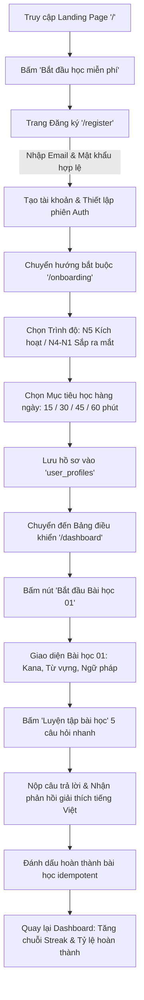
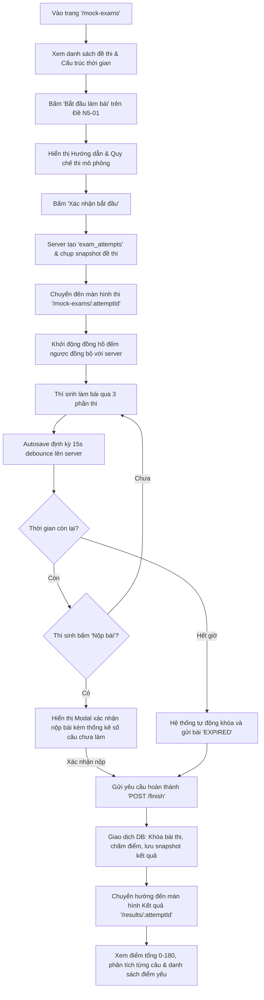
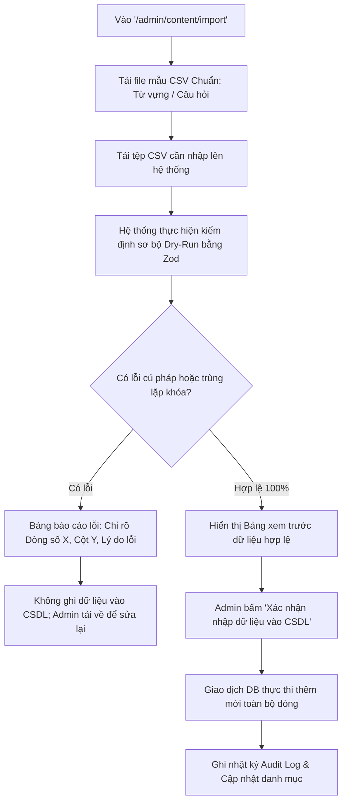

# JLPT Master — User Journey & Flow Specifications

**Document:** `docs/user-flows.md`  
**Phase:** 2 — UI/UX Design (`ui-ux-designer`)  
**Status:** Under Review (Gate Approval Required)  

---

## 1. Flow 1: New Student Onboarding & First Study Cycle



### Detailed State Transitions (Flow 1)
1. **Unauthenticated Visitor:** Visits `/` $\rightarrow$ Clicks primary CTA $\rightarrow$ Routes to `/register`.
2. **Registration Form:** Validates email format, password complexity ($\ge 8$ chars, 1 digit, 1 special char). On submit, server creates `users` record and session cookie.
3. **Onboarding Guard:** Middleware inspects `user_profiles.onboarding_completed_at`. If `null`, redirects to `/onboarding`.
4. **Target Level Selection:** N5 is selectable; N4–N1 display "Sắp ra mắt" with an informative tooltip.
5. **Daily Goal Configuration:** User selects duration slider (default: 30 minutes/day).
6. **First Study Trigger:** Dashboard highlights "Chào mừng bạn! Hãy bắt đầu với Bài 01: Giới thiệu Bảng chữ cái Hiragana".
7. **Practice & Explanation:** Learner completes 5-question mini-quiz. Feedback is instant with highlighted Japanese particles and Vietnamese reasoning.
8. **Completion Event:** Client issues `POST /api/v1/lessons/:id/complete`. Server stores `lesson_progress` idempotently.

---

## 2. Flow 2: Returning Student Daily SRS Review Flow

```mermaid
flowchart TD
    A[Mở ứng dụng / Đăng nhập] --> B[Truy cập '/dashboard']
    B --> C{Số thẻ SRS đến hạn > 0?}
    C -->|Có| D[Nút nổi bật: 'Ôn tập ngay (X thẻ đến hạn)']
    C -->|Không| E[Nút: 'Luyện tập tự do' hoặc 'Học bài tiếp theo']
    D --> F[Vào giao diện Flashcards '/flashcards']
    F --> G[Hiển thị mặt trước thẻ: Kanji / Từ vựng / Mẫu câu]
    G --> H[Bấm lật thẻ hoặc phím Space]
    H --> I[Hiển thị mặt sau: Âm Hán-Việt, Nghĩa, Ví dụ, Âm thanh]
    I --> J[Chọn 1 trong 4 mức nhớ: Again / Hard / Good / Easy]
    J --> K[Gửi đánh giá kèm 'idempotencyKey' duy nhất]
    K --> L[Máy chủ tính toán khoảng cách ôn tập tiếp theo]
    L --> M{Còn thẻ trong hàng đợi?}
    M -->|Còn| G
    M -->|Hết| N[Màn hình chúc mừng 'Đã hoàn thành phiên ôn tập hôm nay!']
    N --> O[Trở về Dashboard: Cập nhật chỉ số tiến độ]
```

### Detailed SRS Mechanics (Flow 2)
1. **Queue Fetch:** `GET /api/v1/reviews/due` fetches cards owned by `current_user` where `due_at <= NOW()` sorted by `due_at ASC`.
2. **Card Presentation:**
   - **Front:** Clean, large font Japanese character(s) + audio button.
   - **Back:** Furigana ruby, Vietnamese meaning, grammatical role, and an example sentence.
3. **Recall Grading Options:**
   - **1 - Again (Chưa nhớ):** Triggers re-test within current session (+10 minutes).
   - **2 - Hard (Khó nhớ):** Minor interval increase (+1 day).
   - **3 - Good (Nhớ tốt):** Standard interval increase (+3 days).
   - **4 - Easy (Rất dễ):** Accelerated interval increase (+7 days).
4. **Idempotency Guarantee:** If the user double-clicks or re-submits due to mobile network fluctuation, `review_logs` rejects duplicate writes for the same `idempotencyKey`.

---

## 3. Flow 3: Timed JLPT N5 Mock Exam Flow



### Detailed Examination Mechanics (Flow 3)
1. **Snapshot Creation:** Starting an exam freezes the question set into `exam_snapshot_json`. Subsequent edits to the question bank by administrators do not distort active or historical attempts.
2. **Timer Authority:** The server stores `expires_at`. The client-side countdown is a synchronized display. Any answer autosave received after `expires_at + 10s grace` is rejected.
3. **Autosave Engine:**
   - Autosave occurs upon selecting an option, debounced to at most 1 network call every 15s.
   - Saves locally to `localStorage.setItem('exam_draft_[id]')` instantly.
   - If user refreshes or closes browser, re-opening `/mock-exams/[attemptId]` restores all chosen answers.
4. **Answer Secrecy:** Pre-submission responses contain only question IDs and option IDs. Answer keys (`is_correct`) and Vietnamese explanations are strictly stripped at the API layer.
5. **Score Finalization:** Executes inside an isolated database transaction. Results page highlights score as an *"Ước tính nội bộ"* to avoid trademark or official certification conflicts.

---

## 4. Flow 4: Content Operations & Publishing Flow (Admin)

```mermaid
flowchart TD
    A[Đăng nhập tài khoản ADMIN/EDITOR] --> B[Vào '/admin/content']
    B --> C[Bấm 'Thêm bài học / Từ vựng / Câu hỏi mới']
    C --> D[Nhập nội dung: Tiếng Nhật, Furigana, Nghĩa tiếng Việt, Giấy phép bản quyền]
    D --> E[Xem trước giao diện thực tế (Live Preview)]
    E --> F[Lưu trạng thái 'DRAFT']
    F --> G[Gửi xét duyệt: Chuyển trạng thái 'IN_REVIEW']
    G --> H[Admin kiểm định nội dung & tính bản quyền]
    H -->|Cần chỉnh sửa| I[Từ chối & Ghi chú lý do phản hồi cho Biên tập viên]
    I --> D
    H -->|Đạt chuẩn| J[Bấm 'Xuất bản' -> Chuyển trạng thái 'PUBLISHED']
    J --> K[Ghi nhật ký 'audit_logs']
    K --> L[Nội dung lập tức hiển thị cho toàn bộ Học viên]
```

---

## 5. Flow 5: Batch CSV Ingestion Flow (Admin)


